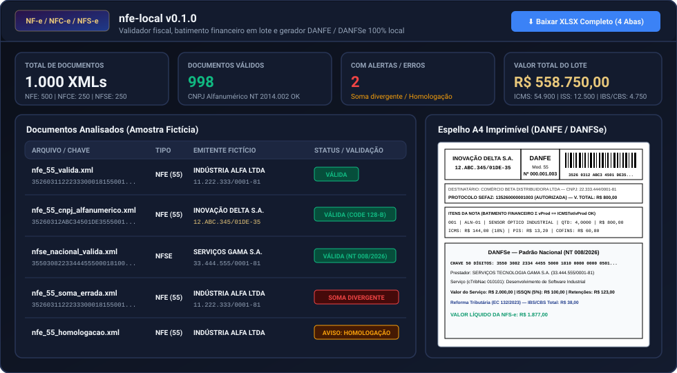
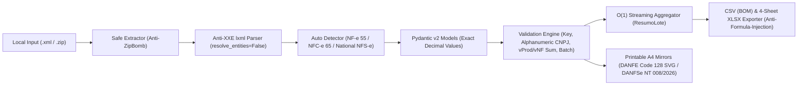

# nfe-local — Local Brazilian Electronic Invoice Viewer, Validator & Batch Analyzer

> 🇧🇷 **Leia em Português:** [README.md](README.md)

A **100% local, deterministic, zero-API-cost** tool for parsing, validating, batch-analyzing, and rendering printable HTML mirrors (**DANFE** and **DANFSe**) of Brazilian electronic tax documents:
- **NF-e** (Model 55 — including early support for **Alphanumeric CNPJ under NT 2014.002 v1.40** and **Tax Reform IBS/CBS**).
- **NFC-e** (Model 65 — retail/consumer electronic invoice).
- **NFS-e** (exclusively the **National Standard** — `sped.fazenda.gov.br/nfse` and **DANFSe NT 008/2026**).

Your XML files never leave your machine: all processing runs locally in Python (`lxml` hardened against XXE, `Pydantic v2` with exact `Decimal` arithmetic, and `FastAPI`).



---

## Project Status

| Module / Feature | Status | How it was verified |
| :--- | :---: | :--- |
| **Anti-XXE Parser for NF-e (55), NFC-e (65), Summary & Events** | ✅ Ready | Automated test suite with synthetic XML fixtures (`nfeProc`, unsigned `NFe`, `resNFe`, `procEventoNFe`, and XXE attack blocking). |
| **National Standard NFS-e Parser (`infNFSe` / `infDPS` / `IBSCBS`)** | ✅ Ready | Verified with 50-digit access keys, ISSQN, federal withholdings (`IRRF`/`CSLL`/`CP`/`PIS`/`COFINS`), Tax Reform (`IBS/CBS`), and explicit rejection of legacy municipal layouts (ABRASF). |
| **Alphanumeric CNPJ & Access Key Validator (NT 2014.002 v1.40)** | ✅ Ready | Unit tests for Modulo 11 check digits via `ord(c) - 48` on 44-char keys and CNPJs containing letters (`12.ABC.345/01DE-35`). |
| **Financial Reconciliation ($\sum \text{items} == \text{vProd}$ & $\text{vNF}$ equation)** | ✅ Ready | Tested with balanced invoices and purposefully mismatched item/total fixtures using exact `Decimal` math. |
| **Streaming Batch Aggregator & CSV / 4-Sheet XLSX Export** | ✅ Ready | Real benchmark with **1,000 XMLs** + protection against *CSV/Excel Formula Injection* and 44/50-char key preservation as text (`@`). |
| **Dark Mode Web UI + Printable A4 Mirrors (DANFE Code 128 & DANFSe)** | ✅ Ready | Integration tests via `TestClient` covering pure-SVG Code 128-C / 128-B barcodes and homologation watermarks. |
| **FastAPI REST API + Agent-Ready CLI** | ✅ Ready | REST endpoints (`/api/lote`, `/exportar`) and `nfe-local analisar --json` subcommand tested end-to-end. |
| **Phase 2 — SEFAZ Inbound Sync (`NFeDistribuicaoDFe` + A1 Certificate)** | 🔜 Planned | Specified in [`docs/BACKLOG.md`](docs/BACKLOG.md) (Tasks 13 to 19). |

---

## Key Features

1. **Multi-File `.xml` & `.zip` Upload:**
   - Processes dozens or thousands of individual XMLs or `.zip` archives in memory (with built-in *zip bomb* and *path traversal* protection).
   - Automatically detects NF-e (55), NFC-e (65), National NFS-e, Summary (`resNFe`), or Event (`procEventoNFe`).
2. **Fiscal, Financial & Batch Validation Engine:**
   - **Rule 1 (Access Key):** validates 44-character keys (numeric or alphanumeric) using Modulo 11 (`ord(c) - 48`) and 50-digit National NFS-e keys.
   - **Rule 2 (Party Documents):** validates CPF (11 digits) and CNPJ (14 numeric or alphanumeric characters per NT 2014.002 v1.40) for issuer and recipient.
   - **Rule 3 (Financial Reconciliation):** checks that item totals ($\sum \text{vProd}$) match the invoice header (`ICMSTot/vProd`) and verifies the `vNF` accounting equation.
   - **Rule 4 (Batch Duplicates):** flags duplicate access keys within the same batch and prevents double counting in financial summaries.
   - **Rule 5 (Operational Alerts):** highlights invoices issued in **Homologation/Testing (`tpAmb=2`)** or missing an **Authorization Protocol (`protNFe`)**.
3. **Printable A4 Mirrors (DANFE & DANFSe NT 008/2026):**
   - **DANFE (NF-e/NFC-e):** portrait A4 layout with detachable receipt stub, zero-dependency **pure-SVG Code 128 barcode** (automatically switching between numeric Subset C and alphanumeric Subset B), installments, tax breakdown, and line items.
   - **DANFSe (National NFS-e):** faithful to **NT 008/2026**, displaying the 50-digit key, Provider, Customer, Service (`cTribNac`/`cNBS`), ISSQN, Federal Withholdings, and Tax Reform (`IBS/CBS`).
4. **Executive Batch Summary & Accounting Export (CSV & XLSX):**
   - Aggregates totals by **Issuer/Provider**, by **Tax** (`ICMS`, `ICMS-ST`, `IPI`, `PIS`, `COFINS`, `ISS`, `Withholdings`, `IBS/CBS`), and by **Period** (`YYYY-MM`).
   - Exports UTF-8 with BOM CSVs and a **4-sheet XLSX workbook** (`Notas`, `Itens`, `Resumo`, `Alertas`).
5. **Automation & AI-Agent Ready CLI:**
   - Run `nfe-local analisar <folder_or_files> --json` to get structured JSON on stdout for scripts, ERPs, or AI agents.

---

## Measured Speed & Memory (1,000-XML Benchmark)

Real measurement executed via [`scripts/benchmark_lote.py`](scripts/benchmark_lote.py) on **Windows 11 (Python 3.12.10, Intel64)** across a mixed batch of **1,000 synthetic XMLs** (250 numeric NF-e 55, 250 NFC-e 65, 250 alphanumeric-CNPJ NF-e 55, and 250 National NFS-e):

| Measured Scenario | Total Time | Throughput | Peak Memory (`tracemalloc`) | Output |
| :--- | :---: | :---: | :---: | :--- |
| **Streaming Mode (`iterar_lote` + `gerar_resumo_lote`)** | **5.92 s** | **169.1 XMLs/s** | **0.63 MB** | Keeps only 1 DOM tree in memory at a time |
| **Full Batch + 4-Sheet XLSX Export (`openpyxl`)** | **14.56 s** | **68.7 XMLs/s** | **32.44 MB** | Generates a complete **275.6 KB** `.xlsx` workbook |

Full methodology and reproduction instructions are available in [`docs/benchmark.md`](docs/benchmark.md).

---

## Installation & Usage

### Option 1: One-Click Windows Installer (Recommended)

1. Double-click **`instalar.bat`**.
   - Checks for Python 3.12, creates an isolated virtual environment outside OneDrive (`%USERPROFILE%\venvs\nfe-local`), installs dependencies, and creates a **"Visualizador NF-e Local"** shortcut on your Desktop.
2. Double-click the Desktop shortcut or **`iniciar.bat`**.
   - Your browser will open `http://127.0.0.1:8765`.
   - Click **"Carregar Lote de Demonstração"** to test immediately with synthetic invoices or drag and drop your `.xml` / `.zip` files.

### Option 2: Command-Line Interface (CLI)

```powershell
# Print batch summary in terminal and export a 4-sheet XLSX report from a folder
nfe-local analisar .\invoices\ --exportar-xlsx fiscal_report.xlsx

# Structured JSON output for scripts or AI agents
nfe-local analisar invoice1.xml batch.zip --json

# Start the local web server manually
nfe-local servidor --host 127.0.0.1 --port 8765
```

### Option 3: Manual Python Setup

```powershell
python -m venv .venv
.\.venv\Scripts\activate
pip install -r requirements.txt
uvicorn api.app:app --host 127.0.0.1 --port 8765
```

### Option 4: Docker

```bash
docker build -t nfe-local:latest .
docker run --rm -p 127.0.0.1:8765:8765 nfe-local:latest
```

---

## How It Works Under the Hood



---

## Known Limitations

1. **Legal Validity of HTML Mirrors (DANFE / DANFSe):**
   - The printable HTML mirrors are auxiliary visual representations for human review and auditing. The legally binding tax document is always the **digitally signed original XML file**.
2. **NFS-e Scope Restricted to the National Standard:**
   - For service invoices (NFS-e), only the **National Standard** (`http://www.sped.fazenda.gov.br/nfse`) is supported. Legacy municipal layouts (such as ABRASF) are explicitly rejected with a clear message, as they are being phased out nationwide.
3. **In-Memory Storage in MVP (Phase 1):**
   - In Phase 1, batches uploaded via the web UI are kept in RAM (LRU cache capped at the last 20 batches). SQLite persistence is scheduled for Phase 2 (`NFeDistribuicaoDFe` SEFAZ sync).

---

## How I used AI (Engineering Log & Human Review)

This project was built incrementally (one task at a time from [`docs/BACKLOG.md`](docs/BACKLOG.md), enforcing strict TDD with `pytest` and `ruff`). Below are the critical areas where naive AI suggestions could have introduced fiscal bugs or security flaws, and how they were caught and fixed:

| Task / Module | What was asked of AI | Pitfall / Risk caught during review | Fix applied & verification |
| :--- | :--- | :--- | :--- |
| **1–2. Synthetic Fixtures & Privacy** | Generate XML fixtures covering NF-e 55, NFC-e 65, National NFS-e, alphanumeric CNPJ, and fiscal defects. | Risk of invalid check digits or accidental real company data. | Built deterministic Modulo 11 generators and privacy audit tests (`test_fixtures.py`) guaranteeing 100% synthetic data. |
| **3. Normalizers & Alphanumeric CNPJ** | Sanitize CNPJ and Access Keys for Pydantic v2 models. | Standard regex `re.sub(r"\D", "", doc)` strips uppercase letters `[A-Z]` from the new Alphanumeric CNPJ (NT 2014.002 v1.40). | Implemented alphanumeric cleaning (`[^0-9A-Za-z]`), safe prefix stripping (`NFe`, `NFS`, `DPS`), and strict `Decimal` conversion. |
| **4. Anti-XXE `lxml` Parser** | Namespace-agnostic parser for NF-e/NFC-e with external entity blocking. | 1) `lxml` raises `FutureWarning` on truthiness checks (`if elem:`); 2) CT-e documents can contain nested `<infNFe>` tags without `<ide>`. | Replaced truthiness checks with `if elem is not None:`, required a direct `<ide>` child on `<infNFe>`, and disabled `resolve_entities` and `load_dtd`. |
| **5. Validation Engine** | Alphanumeric Modulo 11 rules, financial reconciliation, and batch duplicate detection. | Cancellation events (`procEventoNFe`) reference the same `chNFe` as the original invoice and would trigger false duplicate errors. | Scoped `CHAVE_DUPLICADA_LOTE` to primary documents (`NFE`, `NFCE`, `NFSE`, `RESUMO`) and verified the ASCII `ord(c) - 48` formula. |
| **6–7. Detector, ZIP & Streaming Summary** | In-memory `.zip` extraction and batch aggregator for 1,000+ XMLs. | Loading all DOM trees from a large `.zip` simultaneously would exhaust RAM or allow zip bombs. | Added strict decompression quotas and built `AcumuladorResumoLote` in streaming mode ($O(1)$ DOM trees, using just `0.63 MB` for 1,000 XMLs). |
| **8. CSV & XLSX Export** | Generate Excel-ready reports in pt-BR. | 1) Excel converts 44/50-digit numeric keys into scientific notation floats (`3.526E+43`), corrupting trailing digits; 2) Fields starting with `=+-@` enable *Formula Injection*. | Forced `data_type = "s"` and `number_format = "@"` on key/ID columns in `openpyxl` and added `sanitizar_celula_texto` prefixing `'`. |
| **9–10. API, Web UI & Code 128 SVG** | FastAPI endpoints, Dark Mode UI, and 44-char access key SVG barcode. | **Code 128 Subset C** only encodes digit pairs (`00`–`99`) and breaks when the access key contains an alphanumeric CNPJ. | Implemented automatic switching in `barcode_svg`: **Subset C** for 44 numeric digits and **Subset B** for 44 alphanumeric characters. |

---

## Running Tests & Linter

```powershell
ruff check .
ruff format --check .
pytest -v
```

---

## Third-Party Licenses & Project License

Released under the **MIT License** (see [`LICENSE`](LICENSE)). Built on open-source libraries (`FastAPI`, `Uvicorn`, `Pydantic`, `lxml`, `openpyxl`, `cryptography`, and `requests`).
