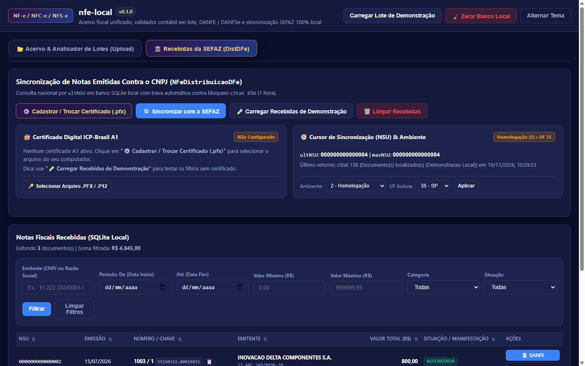
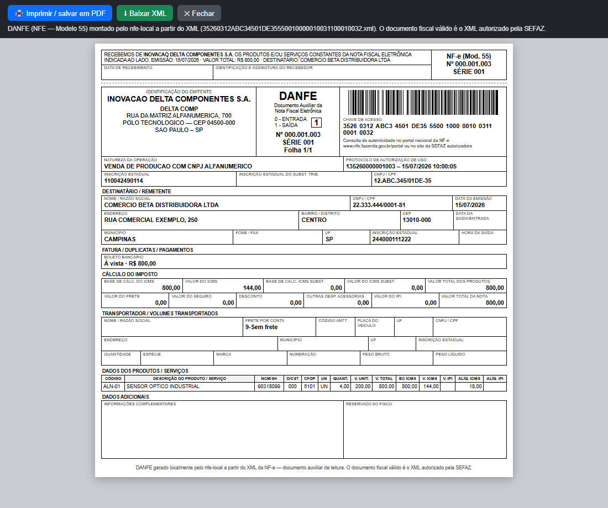
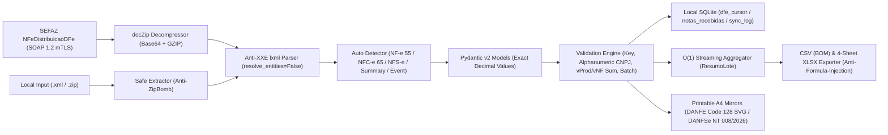

# nfe-local — Local Brazilian Electronic Invoice Viewer, Validator & Batch Analyzer (+ `NFeDistribuicaoDFe`)

> 🇧🇷 **Leia em Português:** [README.md](README.md)

A **100% local, deterministic, zero-mandatory-API-cost** tool for parsing, validating, batch-analyzing, rendering printable HTML mirrors (**DANFE** and **DANFSe**), and synchronizing inbound electronic invoices issued against a company's CNPJ via SEFAZ (**`NFeDistribuicaoDFe`**):
- **NF-e** (Model 55 — including early support for **Alphanumeric CNPJ under NT 2014.002 v1.40** and **Tax Reform IBS/CBS**).
- **NFC-e** (Model 65 — retail/consumer electronic invoice).
- **NFS-e** (exclusively the **National Standard** — `sped.fazenda.gov.br/nfse` and **DANFSe NT 008/2026**).

Your XML files and digital certificate never leave your infrastructure: all processing runs locally in Python (`lxml` hardened against XXE, `Pydantic v2` with exact `Decimal` arithmetic, in-memory `cryptography` PKCS#12, `SQLite`, and `FastAPI`).

### Real screenshots (generated from 100% synthetic data)

| Invoice table (sortable, paginated) | Summary & taxes |
| :---: | :---: |
|  |  |
| **Inbound from SEFAZ (DistDFe)** | **Official DANFE (NF-e 55)** |
|  |  |


> Every screenshot uses the fictitious fixtures in `tests/fixtures/` (made-up companies and CNPJs); no real data appears. The UI itself is in Portuguese.

---

## Project Status

| Module / Feature | Status | How it was verified |
| :--- | :---: | :--- |
| **Anti-XXE Parser for NF-e (55), NFC-e (65), Summary & Events** | ✅ Ready | Automated test suite with synthetic XML fixtures (`nfeProc`, unsigned `NFe`, `resNFe`, `procEventoNFe`, and XXE attack blocking). |
| **National Standard NFS-e Parser (`infNFSe` / `infDPS` / `IBSCBS`)** | ✅ Ready | Verified with 50-digit access keys, ISSQN, federal withholdings (`IRRF`/`CSLL`/`CP`/`PIS`/`COFINS`), Tax Reform (`IBS/CBS`), and explicit rejection of legacy municipal layouts (ABRASF). |
| **Alphanumeric CNPJ & Access Key Validator (NT 2014.002 v1.40)** | ✅ Ready | Unit tests for Modulo 11 check digits via `ord(c) - 48` on 44-char keys and CNPJs containing letters (`12.ABC.345/01DE-35`). |
| **Financial Reconciliation ($\sum \text{items} == \text{vProd}$ & $\text{vNF}$ equation)** | ✅ Ready | Tested with balanced invoices and purposefully mismatched item/total fixtures using exact `Decimal` math. |
| **Streaming Batch Aggregator & CSV / 4-Sheet XLSX Export** | ✅ Ready | Real benchmark with **1,000 XMLs** (`0.63 MB` peak RAM in streaming) + protection against *CSV/Excel Formula Injection* and 44/50-char key preservation as text (`@`). |
| **Dark Mode Web UI + Printable A4 Mirrors (DANFE Code 128 & DANFSe v2.0 with QR Code)** | ✅ Ready | Integration tests via `TestClient` covering pure-SVG Code 128-C / 128-B barcodes, a pure-SVG QR Code on the DANFSe, and homologation watermarks. |
| **FastAPI REST API + Agent-Ready CLI** | ✅ Ready | REST endpoints (`/api/lote`, `/api/recebidas`, `/exportar`) and `nfe-local analisar` / `nfe-local sincronizar-sefaz` CLI commands tested end-to-end. |
| **Optional Analytical Assistant (LLM with SHA-256 Cache & Rate-Limit)** | ✅ Ready | Verified 100% offline with an injected HTTP client. **By default it sends only anonymized accounting aggregates** (issuers as "Emitente 01", no legal names, CNPJs or invoice sample); `LLM_ENVIAR_IDENTIFICADORES=1` and `LLM_ENVIAR_AMOSTRA=1` enable, respectively, real names/CNPJs and the sample of up to 30 invoices. Tests prove that, in the default mode, no identifier appears in what would be sent. Disk cache and hourly quota. See [Optional LLM assistant](#optional-llm-assistant-and-privacy). |
| **Phase 2 — SEFAZ Inbound Sync (`NFeDistribuicaoDFe` + A1 Certificate + SQLite)** | ✅ Ready | Verified with ephemeral in-memory X.509/PKCS#12 certificates, SOAP 1.2 envelopes (`cStat 138`, `137`, and `656`), 1-hour lock against `656` penalties, and 200+ automated tests. |
| **Phase 3 — Persistent Batch History, Unified Archive & Visual A1 Certificate UI** | ✅ Ready | Uploaded batches persist in SQLite (`GET /api/lotes` & deduplicated `GET /api/acervo`), with in-browser `.pfx` upload, password validation, state (`cUFAutor`), and environment switching. |
| **Scale (15,000+ invoices), pagination, clickable sorting & official layouts** | ✅ Ready | Archive listing and summary **never read or decompress** the SQLite `xml_gzip` (on-demand read only when opening details, the DANFE/DANFSe mirror or downloading the XML, backed by a key index), paginated tables (`50 / 100 / 250 / All`), sortable headers and official DANFE/DANFSe v2.0 layouts. ZIP extraction limits raised to 50,000 files / 1 GB (still bounded against *zip bombs*). |

---

## Key Features

1. **Multi-File `.xml` & `.zip` Upload (Phase 1):**
   - Processes dozens or thousands of individual XMLs or `.zip` archives in memory (with built-in *zip bomb* and *path traversal* protection).
   - Automatically detects NF-e (55), NFC-e (65), National NFS-e, Summary (`resNFe`), or Event (`procEventoNFe`).
2. **Fiscal, Financial & Batch Validation Engine:**
   - **Rule 1 (Access Key):** validates 44-character keys (numeric or alphanumeric) using Modulo 11 (`ord(c) - 48`) and 50-digit National NFS-e keys.
   - **Rule 2 (Party Documents):** validates CPF (11 digits) and CNPJ (14 numeric or alphanumeric characters per NT 2014.002 v1.40) for issuer and recipient.
   - **Rule 3 (Financial Reconciliation):** checks that item totals ($\sum \text{vProd}$) match the invoice header (`ICMSTot/vProd`) and verifies the `vNF` accounting equation.
   - **Rule 4 (Batch Duplicates):** flags duplicate access keys within the same batch and prevents double counting in financial summaries.
   - **Rule 5 (Operational Alerts):** highlights invoices issued in **Homologation/Testing (`tpAmb=2`)** or missing an **Authorization Protocol (`protNFe`)**.
3. **Printable A4 Mirrors (DANFE & DANFSe NT 008/2026):**
   - **DANFE (NF-e/NFC-e) — official layout:** portrait A4 with the 9 official blocks (receipt stub, triple header with `0 - ENTRADA / 1 - SAÍDA`, protocol, recipient, installments, tax calculation, carrier/volumes, 14-column item table and additional data) and a zero-dependency **pure-SVG Code 128 barcode** (switching between numeric Subset C and alphanumeric Subset B).
   - **DANFSe v2.0 (National NFS-e) — NT 008/2026:** 50-digit key, Provider, Customer, Service (`cTribNac`/`cNBS`), ISSQN, Federal Withholdings, Tax Reform (`IBS/CBS`), Law 12.741/2012 and a **pure-SVG QR Code** (26 mm × 26 mm) pointing to the national NFS-e public lookup.
4. **Fast Tables for Large Archives (15,000+ invoices):**
   - **On-demand SQLite reads:** archive listing and summary never read or decompress the raw XML; it is only loaded, one invoice at a time, when opening *Detalhes*, the DANFE/DANFSe mirror, or downloading the XML.
   - **Pagination:** the table renders only the active page (`50 / 100 / 250 / All`, default `100`); filtering and sorting still apply to the full set and reset to page 1.
   - **Clickable sorting:** headers sort numerically, chronologically or alphabetically (`⇅` / `▲` / `▼`) on Tabs 1 and 2.
5. **Executive Batch Summary & Accounting Export (CSV & XLSX):**
   - Aggregates totals by **Issuer/Provider**, by **Tax** (`ICMS`, `ICMS-ST`, `IPI`, `PIS`, `COFINS`, `ISS`, `Withholdings`, `IBS/CBS`), and by **Period** (`YYYY-MM`).
   - Exports UTF-8 with BOM CSVs and a **4-sheet XLSX workbook** (`Notas`, `Itens`, `Resumo`, `Alertas`).
6. **Inbound SEFAZ Invoice Synchronization (`NFeDistribuicaoDFe` — Phase 2):**
   - Performs SOAP 1.2 queries with mTLS using an ICP-Brasil A1 certificate (`.pfx`), decompresses `<docZip>` payloads (`base64 + gzip`), persists records in local SQLite, and provides the **"🏛️ Recebidas da SEFAZ (DistDFe)"** tab filterable by issuer, date range, amount, category, and status.

---

## Phase 2: Inbound Invoices (`NFeDistribuicaoDFe`) & Safe A1 Certificate Handling

### 1. Security of the ICP-Brasil e-CNPJ A1 Certificate (`.pfx`)
- **Visual Web UI Configuration or Environment Variables (`.env`):**
  - Directly from the web interface (**🏛️ Recebidas da SEFAZ** tab -> **"⚙️ Cadastrar / Trocar Certificado (.pfx)"**), you can upload your `.pfx`/`.p12` file, enter the password, and select the state (`cUFAutor`) and environment (`Homologation` or `Production`). The pair is validated in memory with `cryptography` before being stored under a fixed safe filename (`certificado.pfx` in the safe folder described in **Where the certificate and password are stored**, outside the project).
  - Alternatively, for headless servers or CLI/Docker automation, configure via `.env`:
  ```ini
  NFE_CERT_PATH=/secure/path/company_a1.pfx
  NFE_CERT_SENHA=your-pfx-password
  NFE_AMBIENTE=homologacao       # homologacao (2, default) or producao (1)
  NFE_UF_AUTOR=35                # IBGE 2-digit state code (e.g. 35 = SP)
  NFE_DB_PATH=data/nfe_recebidas.db
  ```
- **Private key: never in plain text on disk, but there is a temporary file (read the caveat):**
  - The `.pfx` is read and validated in memory with `cryptography` (`sefaz/cert_a1.py`); the password exists only in memory (or encrypted by DPAPI, see below). This project's own code does **not** write `.key` or `.pem` files.
  - **Caveat, stated precisely (per the `requests-pkcs12` library code, version 1.27):** to build the mTLS context, the library creates, **on every new HTTP session** (each `NFeDistribuicaoDFe` or ADN sync round and each diagnostic), a **temporary file in the system temp folder** (`%TEMP%` on Windows). It holds the **private key as PKCS#8 PEM encrypted with a random 128-bit password** (generated on the spot, kept only in process memory, never written) plus the public certificates from the `.pfx`. The library loads the file into the TLS context and deletes it right after, in the same block of code (milliseconds).
  - **What this means:** the private key is never in plain text on disk, but it **touches the disk, encrypted, for an instant**. Deletion is a plain `os.remove` with no overwrite, so remnants may stay on disk until overwritten (common on SSD/NTFS). Because the random password is never stored, a remnant of the key is not usable without the process memory; still, **do not use a synced, monitored, or backup/antivirus-copied temp folder**. This caveat replaces an earlier, inaccurate statement in this README ("no `.pem` is ever written"). Task 28 in `docs/BACKLOG.md` evaluates removing the temporary file.
  - The company's CNPJ is automatically extracted from the ICP-Brasil `SubjectAlternativeName` extension (**OID `2.16.76.1.3.3`**) or the `Common Name`, supporting both numeric and alphanumeric CNPJs.
- **Git & Docker Isolation:**
  - Both `.gitignore` and `.dockerignore` strictly exclude `*.pfx`, `*.p12`, `*.pem`, `*.key`, `.env`, `senha.txt`, `senha.dpapi`, and `data/`.
  - When running in Docker, mount the `.pfx` file as a **read-only volume (`:ro`)** at runtime (never bake certificates into an image):
    ```bash
    docker run --rm -p 127.0.0.1:8765:8765 \
      -v /host/secure/cert.pfx:/run/secrets/cert.pfx:ro \
      -v $(pwd)/data:/app/data \
      -e NFE_CERT_PATH=/run/secrets/cert.pfx \
      -e NFE_CERT_SENHA="your-password" \
      -e NFE_AMBIENTE=homologacao \
      nfe-local:latest
    ```
- **100% Synthetic Test Suite:**
  - The automated test suite (`pytest`) generates ephemeral self-signed X.509/PKCS#12 certificates in memory and uses synthetic SOAP envelopes (`tests/fixtures/sefaz/`), with zero real certificates or tax data in the repository.

### Where the certificate and password are stored

Candidly, this is what exists on disk:

| What | Where | Protection |
| :--- | :--- | :--- |
| `certificado.pfx` | `%LOCALAPPDATA%\nfe-local\certificado\` (Windows default; `~/.local/share/nfe-local/certificado/` on Linux/macOS) | **Not encrypted by this program.** The `.pfx` is protected only by its own password. |
| Password (`senha.dpapi`) | same folder | Encrypted with **Windows DPAPI** (current-user scope): only the same Windows account on the same machine can decrypt it. Never written as plain text. |
| `config.json` | same folder | State code and environment (not secret). |
| SQLite database | `data\nfe_recebidas.db` (or `NFE_DB_PATH`) | **Unencrypted.** |

- Set `NFE_DATA_DIR` to move the data/secrets root; `NFE_CERT_DIR` points straight at the certificate folder and wins.
- **Without DPAPI (Linux, macOS, Docker)** the password is **not written to disk**: set `NFE_CERT_SENHA` in the process environment.
- DPAPI does not protect against malware running as you or someone logged into your account.
- ⚠️ **Never keep the certificate inside synced folders** (OneDrive, Dropbox, Google Drive, iCloud); the UI warns when it detects this.
- **Migration:** old versions stored `data/certificado/` inside the project with a plain-text `senha.txt`. If it exists, the UI offers **"Mover e proteger agora"**, which moves the certificate, protects the password and overwrites/deletes the old files. If that folder was ever synced, cloud version history may still hold copies: consider replacing the certificate.

### 2. SEFAZ Operational Rules Implemented
- **Incremental NSU Synchronization (`ultNSU` / `maxNSU`):**
  - The 15-digit cursor is persisted in `dfe_cursor` after each page (`cStat 138`). Once `ultNSU == maxNSU` or SEFAZ returns `cStat 137` (*No documents found*), pagination stops immediately without extra requests.
- **Strict Protection Against `cStat 656` Lockouts (Improper Consumption):**
  - If SEFAZ returns `cStat 656`, the engine syncs the `ultNSU` reported by SEFAZ and writes a mandatory **1-hour (3,600 s)** cooldown lock (`bloqueado_ate`) into SQLite.
  - Any sync attempt before the lock expires is rejected locally (HTTP `429` in the API / `ErroBloqueioSEFAZ` in the CLI) **without touching the network**, preventing the 1-hour penalty timer from resetting on SEFAZ servers.
- **Summary (`resNFe`) vs. Full Invoice (`procNFe`) & Cancellation Events (`110111`/`110112`):**
  - Invoices initially delivered as `<resNFe>` summaries are flagged with the **`⚠️ Exige Manifestação (210210)`** badge, indicating that *Recipient Manifestation* (e.g., Operation Awareness `210210`) is required to unlock the full `<procNFe>` XML.
  - When the full `<procNFe>` arrives in a later NSU, the SQLite record is **automatically upgraded** to `NFE_COMPLETA` (with anti-downgrade protection if an older summary is reprocessed). Cancellation events (`110111` / `110112`) automatically mark the corresponding invoice as `CANCELADA`.
- **SEFAZ ~90-Day Retention Window:**
  - The national `NFeDistribuicaoDFe` WebService only retains documents for roughly 90 days. Periodic synchronization and regular backups of `data/nfe_recebidas.db` are recommended.

---

## Environment Variables

All are optional. **The program does not read the `.env` file by itself**: `.env.example` is only a template. Set the variables in your terminal (`$env:NAME="value"` in PowerShell), in the Windows environment, or with `docker run --env-file .env` / `-e`.

| Variable | Purpose | Default |
| :--- | :--- | :--- |
| `NFE_CERT_PATH` / `NFE_CERT_SENHA` | Path and password of the A1 certificate (`.pfx`) for headless/CLI use. A certificate registered in the web UI takes priority. | — |
| `NFE_DATA_DIR` | Data and secrets folder; the certificate lives in `<NFE_DATA_DIR>\certificado`. The database stays in `data\` (use `NFE_DB_PATH`). | `%LOCALAPPDATA%\nfe-local` |
| `NFE_CERT_DIR` | Folder of the certificate registered through the UI (wins over `NFE_DATA_DIR`). | `<NFE_DATA_DIR>\certificado` |
| `NFE_AMBIENTE` | `homologacao` (2) or `producao` (1). | `homologacao` |
| `NFE_UF_AUTOR` | IBGE code of the author's state (`cUFAutor`). | `35` |
| `NFE_CNPJ_CONSULTA` | CNPJ/CPF queried in `NFeDistribuicaoDFe`. **If empty, the A1 certificate's CNPJ is used.** Useful when the certificate belongs to an accountant/head office and the query is for another company. A document passed explicitly to the call takes priority over this variable. | Certificate CNPJ |
| `NFE_ADN_URL_BASE` | Base URL of the national NFS-e ADN, with `https://`. Overrides the environment default; `--url-base` on `nfe-local sincronizar-adn` wins. Use `--diagnostico` to test the connection without writing anything. | environment default (see `docs/adn.md`) |
| `NFE_ADN_TENTATIVAS` | Attempts per ADN query when the **connection** fails (1 to 5), with growing waits of 2 s, 5 s and 10 s. Valid HTTP responses, `429` and invalid certificates are not retried. `--tentativas` wins. | `3` |
| `NFE_DB_PATH` | Local SQLite file (batches, inbound invoices, NSU cursor). | `data/nfe_recebidas.db` |
| `LLM_API_KEY` | Enables the Analytical Assistant. **Empty = assistant off** and nothing leaves the computer. | — |
| `LLM_BASE_URL` | OpenAI-compatible endpoint (`/chat/completions`): OpenAI, Gemini (compat mode), Groq, local Ollama, etc. | `https://api.openai.com/v1` |
| `LLM_MODEL` | Model name. | `gpt-4o-mini` |
| `LLM_MAX_CHAMADAS_HORA` | Hourly quota of provider calls (questions answered from the cache do not count). | `20` |
| `LLM_ENVIAR_IDENTIFICADORES` | `1` sends issuers' real legal names and CNPJs to the provider. Off = issuers become codes ("Emitente 01"...). | `0` |
| `LLM_ENVIAR_AMOSTRA` | `1` also sends a sample of up to 30 invoices (problematic ones first). | `0` |

### Optional LLM assistant and privacy

With `LLM_API_KEY` empty, **nothing** is sent over the internet. With the assistant on, **the default mode is private**: each question sends the provider configured in `LLM_BASE_URL` only **anonymized accounting aggregates** (counts, financial totals, tax totals, and totals per issuer and per month).

- **Issuers become stable codes within the batch** (`Emitente 01`, `Emitente 02`...), numbered by CNPJ/CPF order, so the same issuer keeps its code even if the upload order changes. **Legal names and CNPJs are not sent.**
- **The invoice sample is not sent.** The model can answer about totals and taxes, but cannot tell *which invoices* have alerts.
- **Names and CNPJs typed in your question** are replaced by the codes before sending (and the cache uses the already-anonymized question).
- **The translation stays on your computer:** the model answers with codes and the UI shows, right below the answer, the *code → legal name / CNPJ* table, built locally and never sent.
- **Never** sent, in any mode: raw XML, line items, access keys, recipients/customers, the certificate or its password.

Two options, **both off by default**, widen what leaves the computer:

| Option | What is additionally sent |
| :--- | :--- |
| `LLM_ENVIAR_IDENTIFICADORES=1` | Issuers' real legal names and CNPJs (in the summary and in the sample, if enabled). Also sends file names and full alert messages from the sample. |
| `LLM_ENVIAR_AMOSTRA=1` | Sample of up to 30 invoices: type, number, total value, validity and alert codes, with the issuer as a code and `Nota 001`, `Nota 002`... instead of the file name (alert messages omitted). With both options on, the full sample goes out with real names. |

Anonymized does not mean impossible to re-identify: the issuer's state and per-issuer values remain in the aggregates, and someone who knows the batch may work out who is who. If that matters, leave `LLM_API_KEY` empty or point `LLM_BASE_URL` at a local model (e.g. Ollama at `http://127.0.0.1:11434/v1`).

---

## Measured Speed & Memory (1,000-XML Benchmark)

Real measurement executed via [`scripts/benchmark_lote.py`](scripts/benchmark_lote.py) on **Windows 11 (Python 3.12.10, Intel64)** across a mixed batch of **1,000 synthetic XMLs** (250 numeric NF-e 55, 250 NFC-e 65, 250 alphanumeric-CNPJ NF-e 55, and 250 National NFS-e):

| Measured Scenario | Total Time | Throughput | Peak Memory (`tracemalloc`) | Output |
| :--- | :---: | :---: | :---: | :--- |
| **Streaming Mode (`iterar_lote` + `gerar_resumo_lote`)** | **7.07 s** | **141.4 XMLs/s** | **0.63 MB** | Keeps only 1 DOM tree in memory at a time |
| **Full Batch + 4-Sheet XLSX Export (`openpyxl`)** | **7.57 s** | **132.0 XMLs/s** | **32.43 MB** | Generates a complete **275.6 KB** `.xlsx` workbook |

Full methodology and reproduction instructions are available in [`docs/benchmark.md`](docs/benchmark.md).

---

## Installation & Usage

### Option 1: One-Click Windows Installer (Recommended)

1. Double-click **`instalar.bat`**.
   - The script looks for **Python 3.12 only** (`py -3.12` or the default 3.12 install path). If it only finds another version (e.g. 3.13), it tells you which one it found and that it needs 3.12; having other Pythons installed does no harm.
   - If 3.12 is missing and Windows has `winget`, the script **asks `S/N` (yes/no)** before installing Python 3.12, then locates `python.exe` by its full path (no Windows restart needed). Without `winget`, it opens the Python 3.12.x download page.
   - It then creates an isolated virtual environment outside OneDrive (`%USERPROFILE%\venvs\nfe-local`), installs dependencies, runs `pip install -e .` (registers the `nfe-local` command in that environment's `Scripts` folder), and creates a **"Visualizador NF-e Local"** shortcut on your Desktop. Everything is logged to `instalar.log`.
2. Double-click the Desktop shortcut or **`iniciar.bat`**.
   - Your browser will open `http://127.0.0.1:8765`.
   - Use **"Carregar Lote de Demonstração"** on the Batch Analyzer tab, or switch to **"🏛️ Recebidas da SEFAZ (DistDFe)"** and click **"🧪 Carregar Recebidas de Demonstração"** to test the inbound filters without a real A1 certificate.

### Option 2: Command-Line Interface (CLI)

Prerequisite: run `instalar.bat` first (it registers the `nfe-local` command). Activate the environment with `%USERPROFILE%\venvs\nfe-local\Scripts\Activate.ps1` or call `%USERPROFILE%\venvs\nfe-local\Scripts\nfe-local.exe` directly. Without installing the package, use `python -m api.cli` in place of `nfe-local`.

```powershell
# Print batch summary in terminal and export a 4-sheet XLSX report from a folder
nfe-local analisar .\invoices\ --exportar-xlsx fiscal_report.xlsx

# Structured JSON output for scripts or AI agents
nfe-local analisar invoice1.xml batch.zip --json

# Run local simulated SEFAZ DistDFe synchronization with JSON output
nfe-local sincronizar-sefaz --demo --json

# Synchronize inbound invoices from SEFAZ (requires NFE_CERT_PATH and NFE_CERT_SENHA)
nfe-local sincronizar-sefaz --ambiente 2 --db data/nfe_recebidas.db

# Start the local web server manually
nfe-local servidor --host 127.0.0.1 --port 8765

# Wipe the local SQLite database (batches, inbound invoices, NSU cursors and logs) and compact the file.
# Asks for confirmation: type APAGAR (or y). Any other answer cancels without deleting anything.
# Use --sim to skip the prompt (scripts/automation).
nfe-local resetar-banco [--db data/nfe_recebidas.db] [--sim] [--json]
```

### Option 3: Manual Python Setup

```powershell
python -m venv .venv
.\.venv\Scripts\activate
pip install -r requirements.txt
pip install -e .          # registers the nfe-local command (optional)
uvicorn api.app:app --host 127.0.0.1 --port 8765
```

### Option 4: Docker

```bash
docker build -t nfe-local:latest .
docker run --rm -p 127.0.0.1:8765:8765 nfe-local:latest
```

---

## How It Works Under the Hood



---

## Known Limitations

1. **Legal Validity of HTML Mirrors (DANFE / DANFSe):**
   - The printable HTML mirrors are auxiliary visual representations for human review and auditing. The legally binding tax document is always the **digitally signed original XML file**.
2. **NFS-e Scope Restricted to the National Standard:**
   - For service invoices (NFS-e), only the **National Standard** (`http://www.sped.fazenda.gov.br/nfse`) is supported. Legacy municipal layouts (such as ABRASF) are explicitly rejected with a clear message, as they are being phased out nationwide.
3. **A3 Hardware Certificates (USB Token / Smartcard) Not Supported:**
   - The `NFeDistribuicaoDFe` module exclusively supports **A1 Digital Certificates (`.pfx` / PKCS#12)** loaded in memory. Hardware-based PKCS#11 A3 tokens are out of scope.

---

## How I used AI (Engineering Log & Human Review)

This project was built incrementally (one task at a time from [`docs/BACKLOG.md`](docs/BACKLOG.md), enforcing strict TDD with `pytest` and `ruff`). Below are the critical areas where naive AI suggestions could have introduced fiscal bugs or security flaws, and how they were caught and fixed:

| Task / Module | What was asked of AI | Pitfall / Risk caught during review | Fix applied & verification |
| :--- | :--- | :--- | :--- |
| **1–2. Synthetic Fixtures & Privacy** | Generate XML fixtures covering NF-e 55, NFC-e 65, National NFS-e, alphanumeric CNPJ, and fiscal defects. | Risk of invalid check digits or accidental real company data. | Built deterministic Modulo 11 generators and privacy audit tests (`test_fixtures.py`) guaranteeing 100% synthetic data. |
| **3. Normalizers & Alphanumeric CNPJ** | Sanitize CNPJ and Access Keys for Pydantic v2 models. | Standard regex `re.sub(r"\D", "", doc)` strips uppercase letters `[A-Z]` from the new Alphanumeric CNPJ (NT 2014.002 v1.40). | Implemented alphanumeric cleaning (`[^0-9A-Za-z]`), safe prefix stripping (`NFe`, `NFS`, `DPS`), and strict `Decimal` conversion. |
| **4. Anti-XXE `lxml` Parser** | Namespace-agnostic parser for NF-e/NFC-e with external entity blocking. | 1) `lxml` raises `FutureWarning` on truthiness checks (`if elem:`); 2) CT-e documents can contain nested `<infNFe>` tags without `<ide>`. | Replaced truthiness checks with `if elem is not None:`, required a direct `<ide>` child on `<infNFe>`, and disabled `resolve_entities` and `load_dtd`. |
| **5. Validation Engine** | Alphanumeric Modulo 11 rules, financial reconciliation, and batch duplicate detection. | Cancellation events (`procEventoNFe`) reference the same `chNFe` as the original invoice and would trigger false duplicate errors. | Scoped `CHAVE_DUPLICADA_LOTE` to primary documents (`NFE`, `NFCE`, `NFSE`, `RESUMO`) and verified the ASCII `ord(c) - 48` formula. |
| **6–7. Detector, ZIP & Streaming Summary** | In-memory `.zip` extraction and batch aggregator for 1,000+ XMLs. | Loading all DOM trees from a large `.zip` simultaneously would exhaust RAM or allow zip bombs. | Added strict decompression quotas and built `AcumuladorResumoLote` in streaming mode ($O(1)$ DOM trees, using just `0.63 MB` for 1,000 XMLs). |
| **8. CSV & XLSX Export** | Generate Excel-ready reports in pt-BR. | 1) Excel converts 44/50-digit numeric keys into scientific notation floats (`3.526E+43`), corrupting trailing digits; 2) Fields starting with `=+-@` enable *Formula Injection*. | Forced `data_type = "s"` and `number_format = "@"` on key/ID columns in `openpyxl` and added `sanitizar_celula_texto` prefixing `'`. |
| **9–10. API, Web UI & Code 128 SVG** | FastAPI endpoints, Dark Mode UI, and 44-char access key SVG barcode. | **Code 128 Subset C** only encodes digit pairs (`00`–`99`) and breaks when the access key contains an alphanumeric CNPJ. | Implemented automatic switching in `barcode_svg`: **Subset C** for 44 numeric digits and **Subset B** for 44 alphanumeric characters. |
| **11. Infra & Benchmark** | Non-root `Dockerfile`, Windows `.bat` scripts, and 1,000-XML benchmark. | `.bat` files with UTF-8 accented characters break on Windows `cmd.exe` (`CP850`/`CP1252`). | Audited `instalar.bat` and `iniciar.bat` as pure ASCII (`test_infra_benchmark.py`) and measured `0.63 MB` peak RAM with `tracemalloc`. |
| **12. Optional LLM Assistant** | Batch Q&A endpoint with disk cache and hourly rate limit. | Sending raw XMLs would leak sensitive data/waste tokens, and counting rate limits before checking the cache would penalize repeated queries. | Restricted the prompt context to the deterministic `ResumoLote` and checked the `SHA-256` cache before incrementing the hourly rate-limit counter. |
| **13. A1 Certificate & SOAP 1.2** | In-memory PKCS#12 reader and `NFeDistribuicaoDFe` SOAP 1.2 client. | Raw `OtherName` bytes for ICP-Brasil OID `2.16.76.1.3.3` include the ASN.1 DER header (`tag + length`), which in a 14-byte `UTF8String` (`0x0c 0x0e`) leaks into alphanumeric cleaning if stripped by regex alone. | Decoded the ASN.1 DER header prior to document sanitization and used `Pkcs12Adapter` for mTLS. Later correction: that adapter briefly writes a temporary `.pem` (key encrypted with a random password) to the temp folder and deletes it right after; see *Private key* in the Phase 2 section and backlog task 28. |
| **14–15. NSU Control & `docZip`** | `138`/`137`/`656` state machine and `<docZip>` decompressor. | Firing an extra query after reaching `ultNSU == maxNSU` on `cStat 138` triggers SEFAZ `cStat 656` (Improper Consumption). | Stopped the pagination loop immediately when `ultNSU >= maxNSU`, synced the `ultNSU` returned inside `656` rejections, and capped GZIP reads at `10 MB` against *gzip bombs*. |
| **16–18. SQLite, Inbound UI & E2E Tests** | SQLite persistence, filterable Web tab, and simulated E2E suite (`138`, `137`, `656`). | A delayed `resNFe` summary could overwrite an existing full `procNFe`, or repeated UI clicks could reset SEFAZ's 1-hour lock timer. | Enforced anti-downgrade rules (`NFE_COMPLETA` is never overwritten by `RESUMO_NFE`), automatic cancellation updates (`110111`/`110112`), local HTTP `429` blocking during `656` windows, and 100% offline E2E verification. |

### Design decisions and risks considered (tasks 19 to 25)

For tasks 19 to 25 there was **no** concrete failure caught in review: the table above, covering tasks 1 to 18, is the one that records problems identified in review. Here are the **design decisions and risks anticipated** in planning (`docs/BACKLOG.md`) and what was done about each; they are risks considered up front, not bugs found afterwards.

| Decision | Risk considered | How it was handled |
| :--- | :--- | :--- |
| **19. Certificate Documentation** — Document safe `.pfx` handling and how `NFeDistribuicaoDFe` works. | Typical risk: copying the `.pfx` with `COPY` in the `Dockerfile` or committing a `.env` with a password, leaking the certificate into the image or Git. | Documented the `.pfx` as a runtime `:ro` volume, hardened `.gitignore`/`.dockerignore` (`*.pfx`, `*.p12`, `.env`, `data/*.db`) and kept secrets in environment variables only. |
| **20. History & Unified Archive** — Persist uploaded batches in SQLite and consolidate all invoices into one archive. | Summing every batch directly would double-count the same key uploaded twice, inflating financial totals. | The archive summary goes through `gerar_resumo_lote`, which ignores repeated keys in the totals, and the `/api/lote/*` endpoints stay compatible. |
| **21. Visual A1 Certificate Registration** — Upload `.pfx` + password through the web UI and store it locally. | Using the uploaded file name would open *path traversal*, and saving before validating would leave an invalid file on disk. | The `.pfx + password` pair is validated in memory before writing, and the file is always saved under a fixed name (`certificado.pfx`) in a folder outside the project, with the password protected by DPAPI (later review: it used to go to `senha.txt` inside OneDrive). |
| **22. UI Redesign** — "Whole archive" vs. single-batch scope, compact import and sub-views (table, dashboard, assistant). | Browser-only state would make `F5` wipe everything, and the upload area would take half the screen. | The page reloads the archive from SQLite on open; the upload becomes a compact bar with global drag-and-drop. |
| **23. Polish & Database Reset** — Table without horizontal scroll, `resetar-banco` and `.gitignore` hardening. | A fiscal file or generated spreadsheet in the project folder could be committed by accident to a public repo. | `.gitignore` blocks `*.xml`/`*.zip`/`*.csv`/`*.xlsx` outside `tests/fixtures/`; reset exists in the API, CLI and UI (the CLI does not ask for confirmation). |
| **24. Sorting & Official Layouts** — Clickable sorting and DANFE/DANFSe faithful to the official layout. | Rendering the mirror only from the normalized model loses fields that do not fit `DocumentoFiscal` (carrier, ANTT code, DPS, official domains). | Mirror routes pass the raw `xml_bytes` to the renderer, with a fallback to `DocumentoFiscal`; sorting distinguishes numbers, dates and text. |
| **25. QR Code, Lazy Load & Pagination** — QR Code on the DANFSe v2.0 and scale to 15,000+ invoices. | Listing the archive by decompressing every invoice's `xml_gzip` blows memory/time, and rendering thousands of rows freezes the browser. | `obter_acervo_unificado(incluir_xmls_brutos=False)` never touches the XML; `idx_lotes_itens_chave` index + per-invoice reads; DOM holds only the active page; pure-SVG QR Code (`qrcode`, no Pillow). |

---

## Running Tests & Linter

```powershell
ruff check .
ruff format --check .
pytest -v
```

---

## Third-Party Licenses & Project License

Released under the **MIT License** (see [`LICENSE`](LICENSE)). Built on open-source libraries (`FastAPI`, `Uvicorn`, `Pydantic`, `lxml`, `openpyxl`, `cryptography`, `requests`, `requests-pkcs12`, `qrcode`, `Jinja2`, and `python-multipart`).
