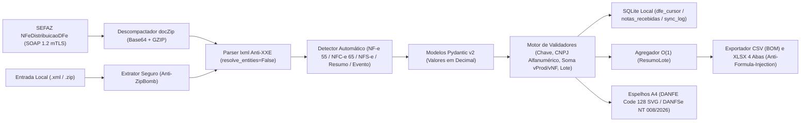

# nfe-local — Visualizador, Validador e Analisador Fiscal em Lote (+ `NFeDistribuicaoDFe`)

> 🇺🇸 **Read this in English:** [README.en.md](README.en.md)

Ferramenta **100% local, determinística e sem custo obrigatório de API** para leitura, validação fiscal/financeira, análise gerencial em lote, geração de espelhos imprimíveis (**DANFE** e **DANFSe**) e sincronização de notas emitidas contra o CNPJ da empresa na SEFAZ (**`NFeDistribuicaoDFe`**):
- **NF-e** (Modelo 55 — incluindo suporte antecipado ao **CNPJ Alfanumérico da NT 2014.002 v1.40** e **Reforma Tributária IBS/CBS**).
- **NFC-e** (Modelo 65 — varejo e consumidor final).
- **NFS-e** (exclusivamente no **Padrão Nacional** — `sped.fazenda.gov.br/nfse` e **DANFSe NT 008/2026**).

Seus arquivos XML e seu certificado digital nunca saem da sua infraestrutura: todo o processamento ocorre localmente via Python (`lxml` blindado contra XXE, `Pydantic v2` com `Decimal` exato, `cryptography` PKCS#12 em memória, `SQLite` e `FastAPI`).


---

## Estado do Projeto

| Módulo / Funcionalidade | Estado | Como foi validado |
| :--- | :---: | :--- |
| **Parser Anti-XXE de NF-e (55), NFC-e (65), Resumo e Evento** | ✅ Pronto | Suíte automatizada com XMLs sintéticos (`nfeProc`, `NFe` sem protocolo, `resNFe`, `procEventoNFe` e bloqueio de ataque XXE). |
| **Parser de NFS-e Padrão Nacional (`infNFSe` / `infDPS` / `IBSCBS`)** | ✅ Pronto | Validado com chaves de 50 dígitos, ISSQN, retenções federais (`IRRF`/`CSLL`/`CP`/`PIS`/`COFINS`), Reforma Tributária (`IBS/CBS`) e rejeição explícita de layouts municipais legados (ABRASF). |
| **Validador de Chave e CNPJ Alfanumérico (NT 2014.002 v1.40)** | ✅ Pronto | Testes unitários do cálculo de Módulo 11 via `ord(c) - 48` para chaves de 44 posições e CNPJs com letras e números (`12.ABC.345/01DE-35`). |
| **Batimento Financeiro ($\sum \text{itens} == \text{vProd}$ e equação $\text{vNF}$)** | ✅ Pronto | Testado com notas íntegras e notas com divergência proposital de centavos/totais (`Decimal` sem ponto flutuante). |
| **Agregador de Lote em Streaming e Exportação CSV / XLSX (4 Abas)** | ✅ Pronto | Benchmark real com **1.000 XMLs** (`0,63 MB` de pico em streaming) + blindagem contra *CSV/Excel Formula Injection* e preservação de chaves de 44/50 posições como texto (`@`). |
| **Interface Web Dark Mode + Espelhos A4 (DANFE Code 128 e DANFSe)** | ✅ Pronto | Testado via `TestClient` com geração de código de barras SVG puro (Code 128-C e Code 128-B) e marca d'água para homologação. |
| **API REST FastAPI + CLI Pronta para Automação e Agentes de IA** | ✅ Pronto | Endpoints REST (`/api/lote`, `/api/recebidas`, `/exportar`) e subcomandos `nfe-local analisar` e `nfe-local sincronizar-sefaz` testados de ponta a ponta. |
| **Assistente Analítico Opcional (LLM com Cache SHA-256 e Rate-Limit)** | ✅ Pronto | Testado 100% offline com cliente HTTP injetado, enviando apenas agregados contábeis (zero XML bruto), cache em disco e franquia horária configurável. |
| **Fase 2 — Busca Automática SEFAZ (`NFeDistribuicaoDFe` + Certificado A1 + SQLite)** | ✅ Pronto | Validado com certificados X.509/PKCS#12 sintéticos em memória, envelopes SOAP 1.2 (`cStat 138`, `137` e `656`), trava de 1h contra bloqueio `656` e mais de 180 testes automatizados. |

---

## Principais Funções

1. **Upload Múltiplo de `.xml` e Pacotes `.zip` (Fase 1):**
   - Recebe dezenas ou milhares de XMLs avulsos ou compactados em `.zip` (com proteção contra *zip bomb* e *path traversal*).
   - Detecta automaticamente se cada arquivo é NF-e (55), NFC-e (65), NFS-e Nacional, Resumo (`resNFe`) ou Evento (`procEventoNFe`).
2. **Motor de Validação Fiscal, Financeira e de Lote:**
   - **Regra 1 (Chave de Acesso):** valida 44 caracteres (numéricos ou alfanuméricos) pelo dígito verificador Módulo 11 (`ord(c) - 48`) e 50 dígitos na NFS-e Nacional.
   - **Regra 2 (Documentos das Partes):** valida CPF (11 dígitos) e CNPJ (14 posições numéricas ou alfanuméricas conforme NT 2014.002 v1.40) de emitente e destinatário.
   - **Regra 3 (Batimento Financeiro):** confere se a soma dos itens ($\sum \text{vProd}$) fecha exatamente com o total da nota (`ICMSTot/vProd`) e valida a equação contábil do `vNF`.
   - **Regra 4 (Duplicidade no Lote):** aponta chaves de acesso duplicadas dentro da mesma remessa e evita dupla contagem nos somatórios financeiros.
   - **Regra 5 (Alertas Operacionais):** destaca notas emitidas em **Ambiente de Homologação (`tpAmb=2`)** ou **Sem Protocolo de Autorização (`protNFe`)**.
3. **Espelhos Imprimíveis A4 (DANFE e DANFSe NT 008/2026):**
   - **DANFE (NF-e/NFC-e):** layout A4 retrato com canhoto destacável, código de barras **Code 128 em SVG puro** (chaveando automaticamente entre Subset C numérico e Subset B alfanumérico), duplicatas, cálculo de impostos e itens.
   - **DANFSe (NFS-e Padrão Nacional):** layout fiel à **NT 008/2026**, exibindo chave de 50 dígitos, Prestador, Tomador, Serviço (`cTribNac`/`cNBS`), ISSQN, Retenções Federais e Reforma Tributária (`IBS/CBS`).
4. **Resumo Gerencial e Exportação Contábil (CSV e XLSX):**
   - Consolida totais por **Emitente/Prestador**, por **Imposto** (`ICMS`, `ICMS-ST`, `IPI`, `PIS`, `COFINS`, `ISS`, `Retenções`, `IBS/CBS`) e por **Período** (`YYYY-MM`).
   - Exporta CSV (UTF-8 com BOM para abrir direto no Excel em português) e planilha **XLSX com 4 abas** (`Notas`, `Itens`, `Resumo` e `Alertas`).
5. **Sincronização de Notas Emitidas Contra o CNPJ (`NFeDistribuicaoDFe` — Fase 2):**
   - Consulta SOAP 1.2 com mTLS em memória usando Certificado Digital A1 (`.pfx`), descompacta lotes `<docZip>` (`base64 + gzip`), armazena no SQLite local e disponibiliza a aba **"🏛️ Recebidas da SEFAZ (DistDFe)"** com filtros por emitente, período, faixa de valor, categoria e situação.

---

## Fase 2: Notas Emitidas Contra o CNPJ (`NFeDistribuicaoDFe`) e Manuseio Seguro do Certificado A1

### 1. Segurança do Certificado Digital e-CNPJ A1 (`.pfx`)
- **Configuração exclusivamente por variáveis de ambiente (`.env`):**
  ```ini
  NFE_CERT_PATH=C:/caminho/seguro/empresa_a1.pfx
  NFE_CERT_SENHA=sua-senha-do-pfx
  NFE_AMBIENTE=homologacao       # homologacao (2, padrão) ou producao (1)
  NFE_UF_AUTOR=35                # Código IBGE da UF do autor (ex.: 35 = SP)
  NFE_DB_PATH=data/nfe_recebidas.db
  ```
- **Zero chave privada desencriptada em disco (mTLS em RAM):**
  - Os módulos `sefaz/cert_a1.py` e `sefaz/dist_dfe.py` leem o arquivo `.pfx` (PKCS#12) via `cryptography` e negociam o handshake mTLS diretamente em memória RAM (`requests-pkcs12`). Nenhuma chave privada `.key` ou certificado `.pem` temporário é extraído no sistema de arquivos.
  - O CNPJ do titular é extraído automaticamente da extensão ICP-Brasil `SubjectAlternativeName` (**OID `2.16.76.1.3.3`**) ou do `Common Name`, suportando inclusive CNPJ alfanumérico.
- **Proteção no Git e no Docker:**
  - `.gitignore` e `.dockerignore` bloqueiam estritamente `*.pfx`, `*.p12`, `*.pem`, `*.key`, `.env`, `senha.txt` e `data/*.db`.
  - Para rodar em container Docker com certificado A1, monte o `.pfx` como volume **somente-leitura (`:ro`)** em tempo de execução (nunca faça `COPY` do certificado no `Dockerfile`):
    ```bash
    docker run --rm -p 127.0.0.1:8765:8765 \
      -v /caminho/host/cert.pfx:/run/secrets/cert.pfx:ro \
      -v $(pwd)/data:/app/data \
      -e NFE_CERT_PATH=/run/secrets/cert.pfx \
      -e NFE_CERT_SENHA="sua-senha" \
      -e NFE_AMBIENTE=homologacao \
      nfe-local:latest
    ```
- **Testes 100% Sintéticos:**
  - A suíte de testes (`pytest`) gera certificados X.509/PKCS#12 autoassinados efêmeros em memória a cada execução e utiliza envelopes SOAP simulados (`tests/fixtures/sefaz/`), sem nenhum certificado ou XML real no repositório.

### 2. Regras Operacionais da SEFAZ Implementadas
- **Sincronização Incremental por NSU (`ultNSU` / `maxNSU`):**
  - O cursor de 15 dígitos é salvo na tabela `dfe_cursor` a cada página recebida (`cStat 138`). Quando `ultNSU == maxNSU` ou a SEFAZ retorna `cStat 137` (*Nenhum documento localizado*), o loop encerra imediatamente sem disparar chamadas redundantes.
- **Proteção Estrita contra Bloqueio `cStat 656` (Consumo Indevido):**
  - Se a SEFAZ retornar `cStat 656`, o sistema sincroniza o `ultNSU` informado pela própria SEFAZ e grava uma trava obrigatória de **1 hora (3.600 segundos)** em `bloqueado_ate` no SQLite.
  - Qualquer tentativa de sincronizar antes do término dessa janela é bloqueada localmente (HTTP `429` na API / `ErroBloqueioSEFAZ` na CLI) **sem tocar na rede**, evitando que o contador de penalidade de 1 hora seja reiniciado na SEFAZ.
- **Resumo (`resNFe`) vs. Nota Completa (`procNFe`) e Eventos (`110111`/`110112`):**
  - Notas entregues inicialmente como `<resNFe>` recebem o badge **`⚠️ Exige Manifestação (210210)`** indicando que é necessário registrar a *Manifestação do Destinatário* (ex.: Ciência da Operação) para que a SEFAZ libere o `<procNFe>` completo.
  - Quando o `<procNFe>` chega em um NSU posterior, o registro no SQLite sofre **upgrade automático** para `NFE_COMPLETA` (com trava anti-downgrade caso um resumo antigo seja reprocessado). Eventos de cancelamento (`110111` / `110112`) atualizam automaticamente a situação da nota para `CANCELADA`.
- **Janela de Retenção de ~90 Dias da SEFAZ:**
  - O WebService `NFeDistribuicaoDFe` disponibiliza documentos emitidos nos últimos ~90 dias. Recomenda-se sincronizar periodicamente e manter backup do arquivo `data/nfe_recebidas.db`.

---

## Velocidade e Memória Medidas (Benchmark de 1.000 XMLs)

Medição real executada via [`scripts/benchmark_lote.py`](scripts/benchmark_lote.py) em **Windows 11 (Python 3.12.10, Intel64)** processando um lote misto de **1.000 XMLs sintéticos** (250 NF-e 55 numéricas, 250 NFC-e 65, 250 NF-e com CNPJ alfanumérico e 250 NFS-e Padrão Nacional):

| Cenário Medido | Tempo Total | Velocidade (Throughput) | Pico de Memória (`tracemalloc`) | Resultado |
| :--- | :---: | :---: | :---: | :--- |
| **Modo Streaming (`iterar_lote` + `gerar_resumo_lote`)** | **5,92 s** | **169,1 XMLs/s** | **0,63 MB** | Mantém apenas 1 árvore DOM por vez em memória |
| **Lote Completo + Exportação XLSX (4 Abas `openpyxl`)** | **14,56 s** | **68,7 XMLs/s** | **32,44 MB** | Gera planilha `.xlsx` completa de **275,6 KB** |

Detalhes completos da metodologia e reprodução estão em [`docs/benchmark.md`](docs/benchmark.md).

---

## Instalação e Como Usar

### Opção 1: Instalador Automático no Windows (Recomendado)

1. Dê dois cliques em **`instalar.bat`**.
   - O script verifica o Python 3.12, cria um ambiente virtual isolado fora do OneDrive (`%USERPROFILE%\venvs\nfe-local`), instala as dependências e cria o atalho **"Visualizador NF-e Local"** na sua Área de Trabalho.
2. Dê dois cliques no atalho da Área de Trabalho ou em **`iniciar.bat`**.
   - O navegador abrirá automaticamente em `http://127.0.0.1:8765`.
   - Na aba **Analisador de Lotes**, clique em **"Carregar Lote de Demonstração"**; na aba **Recebidas da SEFAZ (DistDFe)**, clique em **"🧪 Carregar Recebidas de Demonstração"** para testar os filtros sem precisar de certificado A1 real.

### Opção 2: Via Linha de Comando (CLI)

```powershell
# Exibir resumo gerencial no terminal e exportar planilha XLSX de uma pasta inteira
nfe-local analisar .\minhas_notas\ --exportar-xlsx relatorio_fiscal.xlsx

# Saída em JSON estruturado para consumo por scripts ou agentes de IA
nfe-local analisar nota1.xml pacote.zip --json

# Sincronizar notas recebidas (DistDFe) em modo demonstração local com saída JSON
nfe-local sincronizar-sefaz --demo --json

# Sincronizar notas recebidas reais na SEFAZ (requer NFE_CERT_PATH e NFE_CERT_SENHA)
nfe-local sincronizar-sefaz --ambiente 2 --db data/nfe_recebidas.db

# Iniciar o servidor web manualmente
nfe-local servidor --host 127.0.0.1 --port 8765
```

### Opção 3: Instalação Manual via Python

```powershell
python -m venv .venv
.\.venv\Scripts\activate
pip install -r requirements.txt
uvicorn api.app:app --host 127.0.0.1 --port 8765
```

### Opção 4: Via Docker

```bash
docker build -t nfe-local:latest .
docker run --rm -p 127.0.0.1:8765:8765 nfe-local:latest
```

---

## Como Funciona por Baixo



---

## Limitações Conhecidas

1. **Validade Jurídica dos Espelhos HTML (DANFE / DANFSe):**
   - Os espelhos gerados em tela/impressão são representações visuais auxiliares para conferência humana e auditoria rápida. O documento fiscal com validade jurídica perante o Fisco é sempre o arquivo **XML original assinado digitalmente**.
2. **Escopo de NFS-e Restrito ao Padrão Nacional:**
   - Para Nota Fiscal de Serviço Eletrônica (NFS-e), o sistema suporta **exclusivamente o Padrão Nacional** (`http://www.sped.fazenda.gov.br/nfse`). Layouts municipais proprietários ou legados (como ABRASF, Ginfes, Betha etc.) são rejeitados com alerta explícito, pois estão em processo de descontinuação nacional.
3. **Certificados A3 (Token USB / Smartcard) Não Suportados:**
   - O módulo `NFeDistribuicaoDFe` suporta exclusivamente **Certificado Digital A1 (`.pfx` / PKCS#12)** lido em memória. Certificados A3 em hardware criptográfico via PKCS#11 não fazem parte do escopo.

---

## Como usei IA (Registro de Engenharia e Revisão Humana)

O projeto foi desenvolvido de forma incremental (uma tarefa por vez do [`docs/BACKLOG.md`](docs/BACKLOG.md), seguindo TDD estrito com `pytest` e linter `ruff`). Abaixo estão os pontos críticos em que sugestões padrão de IA poderiam introduzir bugs fiscais ou vulnerabilidades e como foram corrigidos:

| Tarefa / Módulo | O que foi solicitado à IA | Risco / Armadilha identificada na revisão | Correção aplicada e validação |
| :--- | :--- | :--- | :--- |
| **1–2. Fixtures e Privacidade** | Gerar suíte de XMLs cobrindo NF-e 55, NFC-e 65, NFS-e Nacional, CNPJ alfanumérico e defeitos fiscais. | Risco de usar chaves com dígito verificador inválido ou dados reais acidentais. | Criei cálculo determinístico de DV Módulo 11 e testes de auditoria (`test_fixtures.py`) garantindo dados 100% fictícios. |
| **3. Normalizadores e CNPJ Alfanumérico** | Limpeza de CNPJ e Chave de Acesso para os modelos Pydantic v2. | Sugestões genéricas usam `re.sub(r"\D", "", doc)`, o que apaga as letras `[A-Z]` do novo CNPJ Alfanumérico (NT 2014.002 v1.40). | Implementei limpeza alfanumérica (`[^0-9A-Za-z]`), remoção segura de prefixos (`NFe`, `NFS`, `DPS`) e conversão monetária estrita em `Decimal`. |
| **4. Parser `lxml` Anti-XXE** | Parser agnóstico de namespace para NF-e/NFC-e e bloqueio de entidades externas. | 1) `lxml` emite `FutureWarning` ao testar elementos com `if elem:`; 2) CT-e pode conter `<infNFe>` aninhado sem `<ide>`. | Substituí checagens implícitas por `if elem is not None:`, exigi filho direto `<ide>` em `<infNFe>` e desativei `resolve_entities` e `load_dtd`. |
| **5. Motor de Validadores** | Regras de Módulo 11 alfanumérico, batimento financeiro e duplicidade no lote. | Eventos (`procEventoNFe`) referenciam a mesma `chNFe` da nota original e seriam marcados erroneamente como duplicados. | Restringi a trava de `CHAVE_DUPLICADA_LOTE` aos documentos principais (`NFE`, `NFCE`, `NFSE`, `RESUMO`), validando a fórmula ASCII `ord(c) - 48`. |
| **6–7. Detector, ZIP e Resumo Streaming** | Extração de `.zip` em memória e agregador para 1.000+ XMLs. | Carregar todas as árvores DOM de um `.zip` grande esgotaria a memória RAM (ou abriria brecha para *zip bomb*). | Implementei limites estritos de descompactação e o `AcumuladorResumoLote` em streaming ($O(1)$ árvores DOM, gastando apenas `0,63 MB` para 1.000 XMLs). |
| **8. Exportação CSV e XLSX** | Geração de relatórios compatíveis com Excel pt-BR. | 1) Excel converte chaves numéricas de 44/50 dígitos em float (`3,526E+43`), destruindo os dígitos finais; 2) Razão social iniciada por `=+-@` permite *Formula Injection*. | Forcei `data_type = "s"` e `number_format = "@"` nas colunas de chave/documento do `openpyxl` e criei `sanitizar_celula_texto` prefixando `'`. |
| **9–10. API, Web e Code 128 SVG** | Endpoints FastAPI, UI Dark Mode e código de barras SVG da chave de 44 posições. | O padrão **Code 128 Subset C** codifica apenas pares de dígitos (`00`–`99`) e falha quando a chave possui CNPJ alfanumérico. | Implementei chaveamento automático em `barcode_svg`: **Subset C** para chaves de 44 dígitos numéricos e **Subset B** para chaves de 44 posições alfanuméricas. |
| **11. Infra e Benchmark** | `Dockerfile` não-root, scripts `.bat` e medição real para 1.000 XMLs. | Scripts `.bat` com caracteres UTF-8 acentuados quebram no `cmd.exe` em Windows `CP850`/`CP1252`. | Auditei `instalar.bat` e `iniciar.bat` em ASCII puro (`test_infra_benchmark.py`) e medi `0,63 MB` de pico de RAM com `tracemalloc`. |
| **12. Assistente LLM Opcional** | Endpoint de perguntas sobre o lote com cache em disco e rate-limit. | Enviar XMLs brutos vazaria dados sensíveis/estouraria tokens, e cobrar quota antes de checar o cache penalizaria perguntas repetidas. | O prompt envia apenas o `ResumoLote` determinístico e verifica o cache `SHA-256` antes de incrementar o contador horário de chamadas. |
| **13. Certificado A1 e SOAP 1.2** | Leitor PKCS#12 em memória e cliente SOAP 1.2 `NFeDistribuicaoDFe`. | O valor bruto `OtherName` do OID ICP-Brasil `2.16.76.1.3.3` inclui cabeçalho ASN.1 DER (`tag + length`), que em `UTF8String` de 14 bytes (`0x0c 0x0e`) vira caracter alfanumérico se limpo apenas por regex. | Decodifiquei o cabeçalho ASN.1 DER antes de limpar o documento e usei `Pkcs12Adapter` para negociar mTLS em memória sem gravar `.pem` em disco. |
| **14–15. Controle de NSU e `docZip`** | Máquina de estados `138`/`137`/`656` e descompactador `<docZip>`. | Fazer uma nova consulta após atingir `ultNSU == maxNSU` no `cStat 138` dispara rejeição `656` (Consumo Indevido) na SEFAZ. | O loop encerra imediatamente quando `ultNSU >= maxNSU`, sincroniza o `ultNSU` devolvido na própria rejeição `656` e limita a leitura GZIP em `10 MB` contra *gzip bomb*. |
| **16–18. SQLite, Tela Recebidas e Testes E2E** | Persistência SQLite, aba Web filtrável e suíte E2E simulada (`138`, `137`, `656`). | Um `resNFe` atrasado poderia sobrescrever um `procNFe` completo já salvo, ou cliques repetidos na UI poderiam reiniciar o bloqueio de 1h da SEFAZ. | Adicionei proteção contra downgrade (`NFE_COMPLETA` nunca volta a `RESUMO_NFE`), reflexo automático de cancelamento (`110111`/`110112`), bloqueio HTTP `429` local durante a janela do `656` e validação E2E 100% offline. |

---

## Como Rodar os Testes e o Linter

```powershell
# Verificar estilo, segurança (bandit/ruff S) e formatação
ruff check .
ruff format --check .

# Executar toda a suíte de testes automatizados (180+ testes 100% offline)
pytest -v
```

---

## Licenças de Terceiros e Licença do Projeto

Distribuído sob a licença **MIT** (veja [`LICENSE`](LICENSE)). Utiliza bibliotecas de código aberto compatíveis (`FastAPI`, `Uvicorn`, `Pydantic`, `lxml`, `openpyxl`, `cryptography`, `requests` e `requests-pkcs12`).
