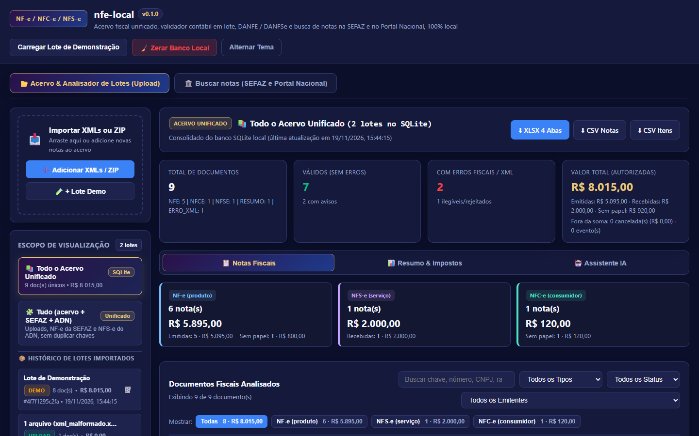
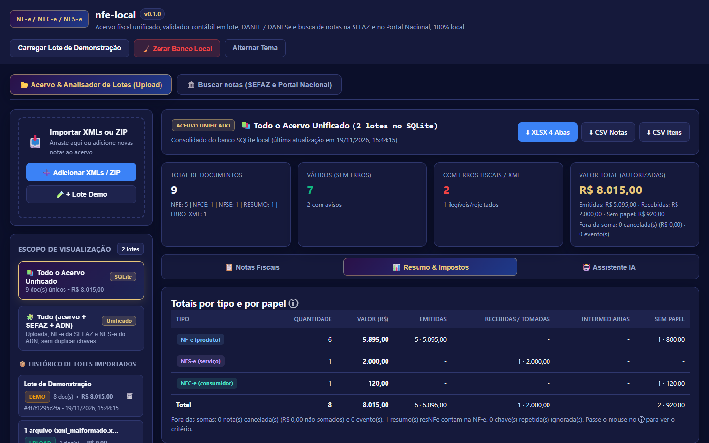
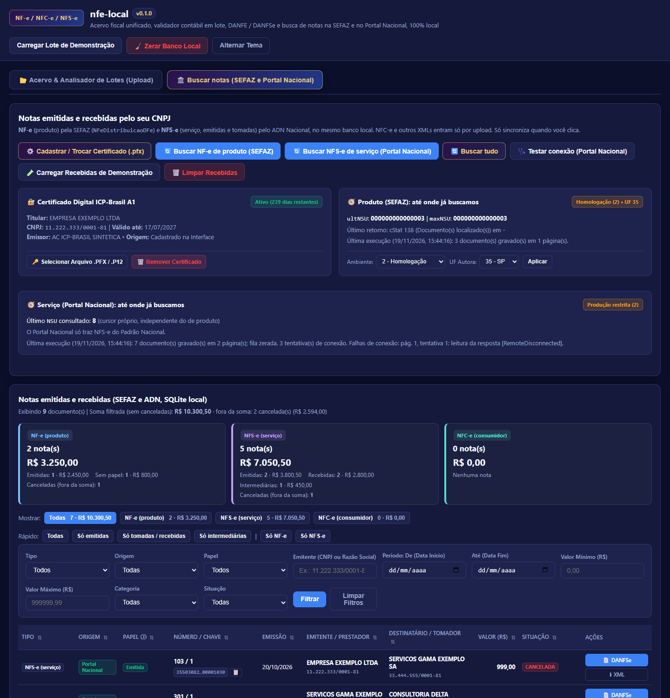
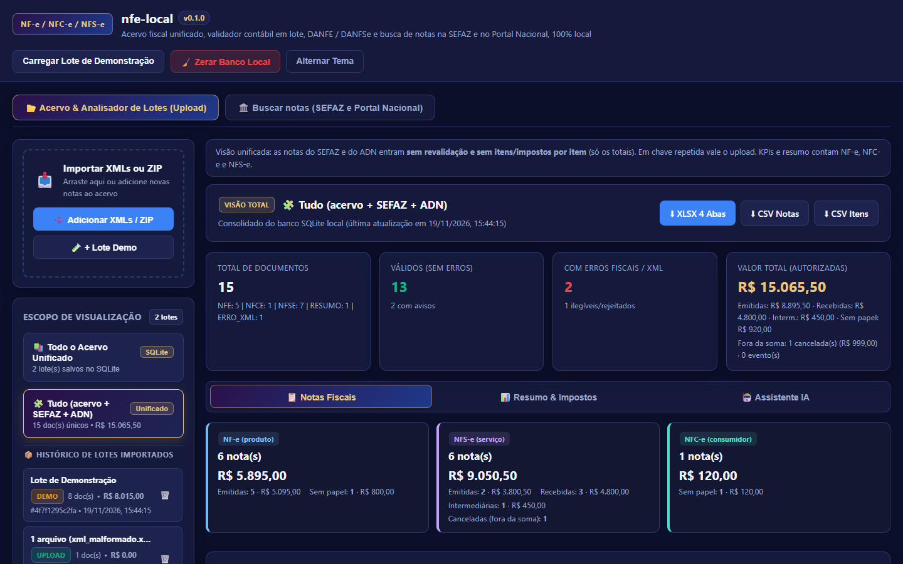
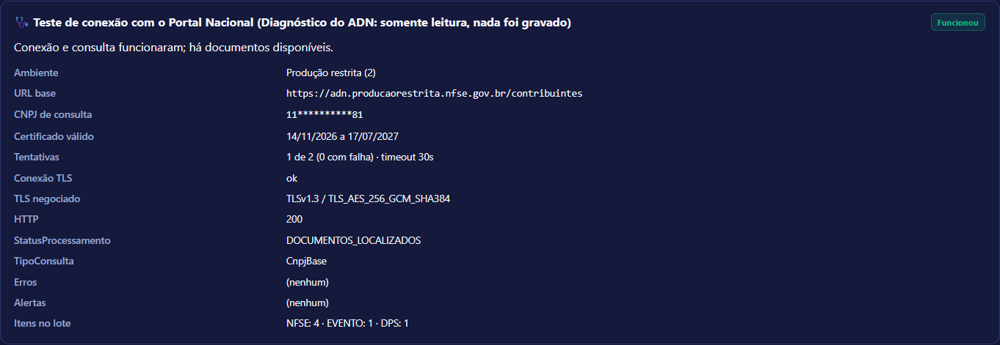
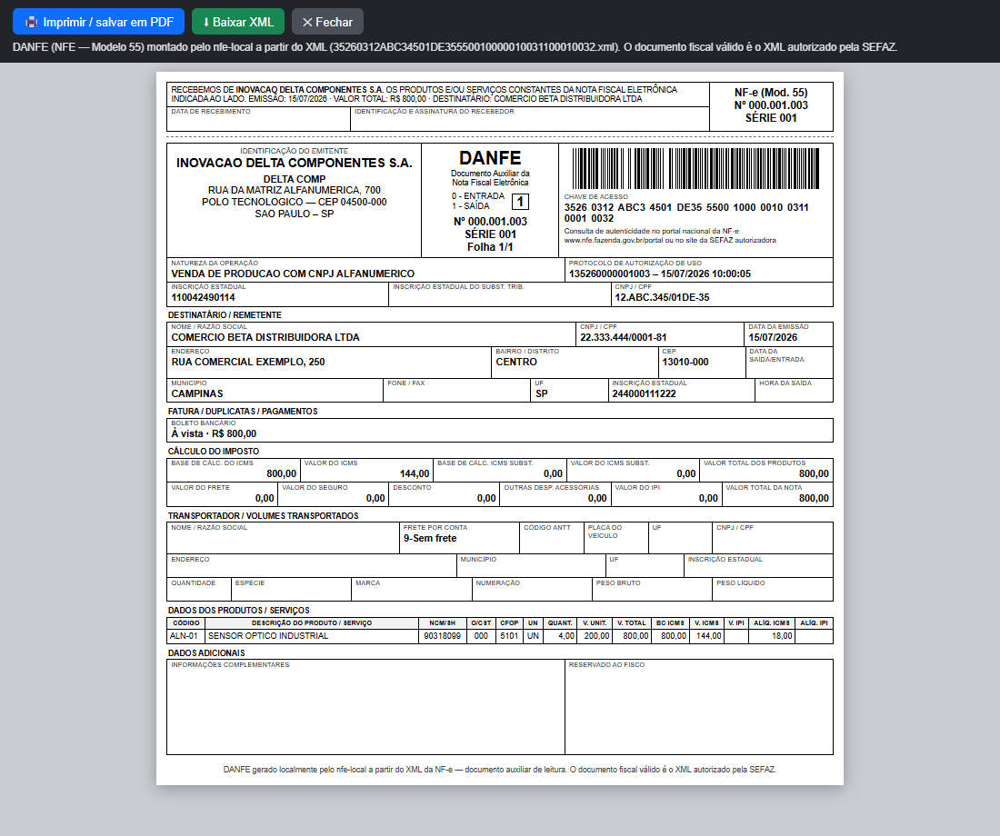
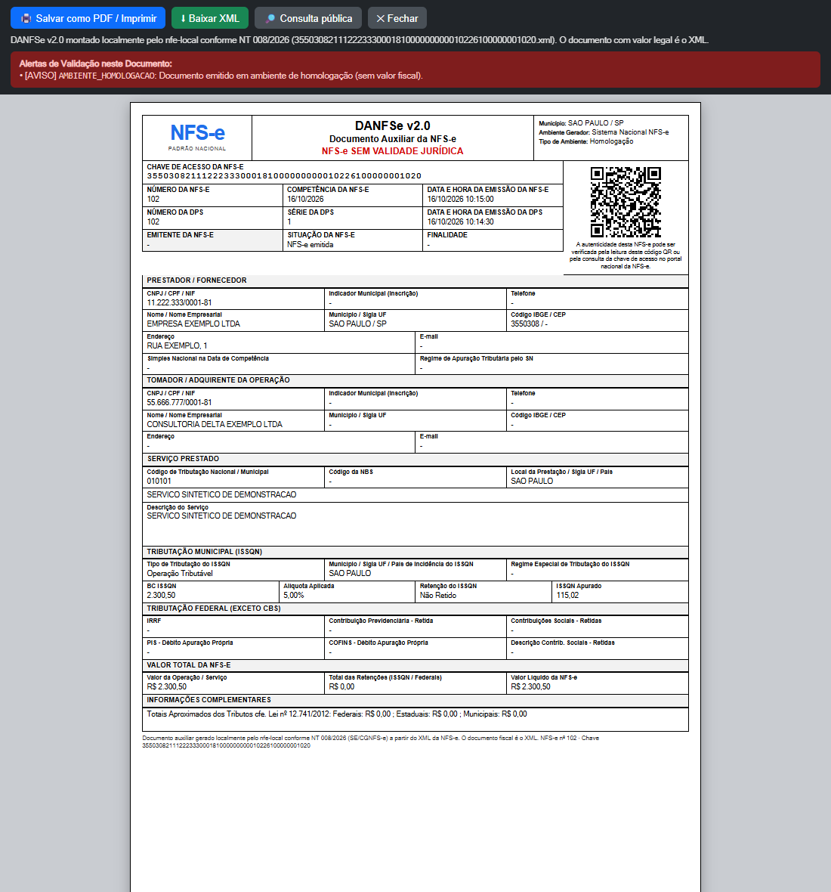
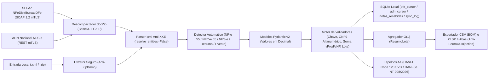

# nfe-local — Visualizador, Validador e Analisador Fiscal em Lote (+ SEFAZ e ADN)

> 🇺🇸 **Read this in English:** [README.en.md](README.en.md)

Ferramenta **100% local, determinística e sem custo obrigatório de API** para leitura, validação fiscal/financeira, análise gerencial em lote, geração de espelhos imprimíveis (**DANFE** e **DANFSe**) e busca automática das notas do CNPJ da empresa: **NF-e pela SEFAZ** (**`NFeDistribuicaoDFe`**) e **NFS-e pelo ADN Nacional** (emitidas e tomadas):
- **NF-e** (Modelo 55 — incluindo suporte antecipado ao **CNPJ Alfanumérico da NT 2014.002 v1.40** e **Reforma Tributária IBS/CBS**).
- **NFC-e** (Modelo 65 — varejo e consumidor final).
- **NFS-e** (exclusivamente no **Padrão Nacional** — `sped.fazenda.gov.br/nfse` e **DANFSe NT 008/2026**).

Seus arquivos XML e seu certificado digital nunca saem da sua infraestrutura: todo o processamento ocorre localmente via Python (`lxml` blindado contra XXE, `Pydantic v2` com `Decimal` exato, `cryptography` PKCS#12 em memória, `SQLite` e `FastAPI`).

### Telas reais (geradas com dados 100% sintéticos)

| Tabela de notas (ordenável, paginada) | Resumo & impostos |
| :---: | :---: |
|  |  |
| **Buscar notas (SEFAZ e Portal Nacional): NF-e de produto e NFS-e de serviço, com Origem e Papel** | **Escopo "Tudo" (acervo + SEFAZ + ADN)** |
|  |  |
| **Testar conexão (Portal Nacional) = Diagnóstico do ADN, somente leitura** | **DANFE oficial (NF-e 55)** |
|  |  |



> Todas as telas usam as fixtures fictícias de `tests/fixtures/` (empresas e CNPJs inventados); nenhum dado real aparece.

---

## Escopo: o que cada fonte traz

| Documento | Como entra | Papel do seu CNPJ | Observação |
| :--- | :--- | :--- | :--- |
| **NF-e de produto (modelo 55)** | **SEFAZ** (`NFeDistribuicaoDFe`, busca automática) ou upload | O que a SEFAZ distribui ao CNPJ (em geral notas **destinadas/recebidas**; o resumo `resNFe` exige manifestação para liberar o XML) | Este projeto **não confirmou** que o `NFeDistribuicaoDFe` entregue as NF-e **emitidas pelo próprio CNPJ**; para essas, use upload. A coluna **Papel** mostra o que de fato veio. |
| **NFS-e emitidas** (CNPJ como prestador) | **ADN Nacional** (busca automática) ou upload | Emitida | Somente NFS-e no Padrão Nacional. |
| **NFS-e tomadas** (CNPJ como tomador) | **ADN Nacional** ou upload | Recebida | No mesmo fluxo e na mesma consulta das emitidas. |
| **NFS-e com o CNPJ como intermediário** | **ADN Nacional** ou upload | Intermediária | |
| **NFC-e (modelo 65)** | **Somente upload** | — | Nem a SEFAZ nem o ADN são consultados para NFC-e. |
| **Qualquer outro XML** (evento avulso, NFS-e municipal legada etc.) | **Somente upload** | — | NFS-e de layout municipal legado (ABRASF etc.) é rejeitada com alerta. |

A aba **Buscar notas (SEFAZ e Portal Nacional)** mostra o que foi buscado automaticamente (Tipo, Origem, Papel, situação, espelho e XML), com **cartões por tipo** (**NF-e (produto)**, **NFS-e (serviço)** e **NFC-e (consumidor)**: quantidade, valor e emitidas versus recebidas), um **seletor de tipo** com a contagem e o valor de cada um e filtros rápidos (*Só emitidas*, *Só tomadas*, *Só NF-e*, *Só NFS-e*). Os nomes técnicos (SEFAZ, ADN, NSU, `NFeDistribuicaoDFe`) aparecem como dica ao passar o mouse. O **Portal Nacional** (ADN) só traz NFS-e do **Padrão Nacional**. O escopo **"Tudo (acervo + SEFAZ + ADN)"**, na primeira aba, soma uploads, SEFAZ e ADN **sem duplicar chaves** (em chave repetida vale o upload) e os KPIs e o resumo contam NF-e, NFC-e e NFS-e. As notas do SEFAZ/ADN entram nessa visão sem revalidação e **sem itens e impostos por item** (só os totais).

### O que entra nas somas e nos KPIs

- **Valor total (autorizadas)** soma NF-e (produto), NFS-e (serviço) e NFC-e (consumidor) **autorizadas**, sem repetir a mesma chave, e é mostrado **separado por tipo e por papel** (emitidas versus recebidas/tomadas, e intermediárias). O resumo `resNFe` conta na NF-e.
- **Notas canceladas e eventos ficam fora das somas de valor** e aparecem à parte, com a contagem (e o valor das canceladas que não foi somado).
- **Papel** compara o CNPJ de consulta (o do certificado) com o emitente/prestador e o destinatário/tomador; sem esse CNPJ de referência a nota entra em "Sem papel". O critério aparece em uma dica (ⓘ) na tela.
- No painel **Resumo**, a lista **XMLs ilegíveis (ERRO_XML)** mostra o arquivo, o código e o motivo, com filtro por texto e por motivo.
- A aba **Resumo** das planilhas exportadas usa o mesmo cálculo e também deixa as canceladas de fora (a aba **Notas** continua listando todas as notas).

---

## Estado do Projeto

| Módulo / Funcionalidade | Estado | Como foi validado |
| :--- | :---: | :--- |
| **Parser Anti-XXE de NF-e (55), NFC-e (65), Resumo e Evento** | ✅ Pronto | Suíte automatizada com XMLs sintéticos (`nfeProc`, `NFe` sem protocolo, `resNFe`, `procEventoNFe` e bloqueio de ataque XXE). |
| **Parser de NFS-e Padrão Nacional (`infNFSe` / `infDPS` / `IBSCBS`)** | ✅ Pronto | Validado com chaves de 50 dígitos, ISSQN, retenções federais (`IRRF`/`CSLL`/`CP`/`PIS`/`COFINS`), Reforma Tributária (`IBS/CBS`) e rejeição explícita de layouts municipais legados (ABRASF). |
| **Validador de Chave e CNPJ Alfanumérico (NT 2014.002 v1.40)** | ✅ Pronto | Testes unitários do cálculo de Módulo 11 via `ord(c) - 48` para chaves de 44 posições e CNPJs com letras e números (`12.ABC.345/01DE-35`). |
| **Batimento Financeiro ($\sum \text{itens} == \text{vProd}$ e equação $\text{vNF}$)** | ✅ Pronto | Testado com notas íntegras e notas com divergência proposital de centavos/totais (`Decimal` sem ponto flutuante). |
| **Agregador de Lote em Streaming e Exportação CSV / XLSX (4 Abas)** | ✅ Pronto | Benchmark real com **1.000 XMLs** (`0,63 MB` de pico em streaming) + blindagem contra *CSV/Excel Formula Injection* e preservação de chaves de 44/50 posições como texto (`@`). |
| **Interface Web Dark Mode + Espelhos A4 (DANFE Code 128 e DANFSe v2.0 com QR Code)** | ✅ Pronto | Testado via `TestClient` com código de barras SVG puro (Code 128-C e 128-B), QR Code SVG puro no DANFSe e marca d'água para homologação. |
| **API REST FastAPI + CLI Pronta para Automação e Agentes de IA** | ✅ Pronto | Endpoints REST (`/api/lote`, `/api/recebidas`, `/exportar`) e subcomandos `nfe-local analisar` e `nfe-local sincronizar-sefaz` testados de ponta a ponta. |
| **Assistente Analítico Opcional (LLM com Cache SHA-256 e Rate-Limit)** | ✅ Pronto | Testado 100% offline com cliente HTTP injetado. **Por padrão envia só agregados contábeis anonimizados** (emitentes como "Emitente 01", sem razão social, CNPJ nem amostra de notas); `LLM_ENVIAR_IDENTIFICADORES=1` e `LLM_ENVIAR_AMOSTRA=1` liberam, respectivamente, nomes/CNPJ reais e a amostra de até 30 notas. Testes provam que, no modo padrão, nenhum identificador aparece no que seria enviado. Cache em disco e franquia horária. Veja [Assistente LLM opcional](#assistente-llm-opcional-e-privacidade). |
| **Fase 2 — Busca Automática SEFAZ (`NFeDistribuicaoDFe` + Certificado A1 + SQLite)** | ✅ Pronto | Validado com certificados X.509/PKCS#12 sintéticos em memória, envelopes SOAP 1.2 (`cStat 138`, `137` e `656`), trava de 1h contra bloqueio `656` e mais de 440 testes automatizados na suíte atual. |
| **Fase 3 — Histórico Persistente, Acervo Unificado e Gestão Visual do Certificado A1** | ✅ Pronto | Todos os lotes enviados persistem no SQLite (`GET /api/lotes` e `GET /api/acervo` deduplicado), com cadastro visual de `.pfx` + senha + UF + ambiente na interface web sem depender de edição manual de `.env`. |
| **Escala (15.000+ notas), paginação, ordenação clicável e layouts oficiais** | ✅ Pronto | Listagem e resumo do acervo **sem ler nem descompactar** o `xml_gzip` do SQLite (leitura sob demanda só ao abrir detalhe, DANFE/DANFSe ou baixar XML, com índice na chave), tabelas paginadas (`50 / 100 / 250 / Todas`) e ordenáveis, DANFE/DANFSe v2.0 oficiais. Limites de extração de ZIP elevados para 50.000 arquivos / 1 GB (ainda limitados contra *zip bomb*). |
| **Fase 4 — NFS-e pelo ADN Nacional (emitidas e tomadas) e visão única** | ✅ Validado em uso real | **Validado:** respostas simuladas (testes automatizados, sem rede); em **19/11/2026**, o diagnóstico real em **produção restrita e em produção** (TLS ok, HTTP 200, `DOCUMENTOS_LOCALIZADOS`, `TipoConsulta CnpjBase`); a sincronização de **uma página** em produção trouxe **50 NFS-e novas**; e a sincronização **completa** em produção (**19/11/2026**) percorreu **10 páginas**, zerou a fila e gravou **411 documentos (391 NFS-e novas e 20 eventos)**, com os papéis prestador, tomador e intermediário, sem erro de processamento e sem falhas de conexão na rodada. Houve falhas de conexão intermitentes em tentativas anteriores, hoje tratadas com repetição automática. **Ressalva:** o papel de **intermediário** vem de uma leitura do XML (`<interm>`) que o Swagger não confirma. |

---

## Principais Funções

1. **Upload Múltiplo de `.xml` e Pacotes `.zip` (Fase 1):**
   - Recebe dezenas ou milhares de XMLs avulsos ou compactados em `.zip` (com proteção contra *zip bomb* e *path traversal*).
   - Detecta automaticamente se cada arquivo é NF-e (55), NFC-e (65), NFS-e Nacional, Resumo (`resNFe`) ou Evento (`procEventoNFe`).
2. **Motor de Validação Fiscal, Financeira e de Lote:**
   - **Regra 1 (Chave de Acesso):** valida 44 caracteres (numéricos ou alfanuméricos) pelo dígito verificador Módulo 11 (`ord(c) - 48`) e 50 dígitos na NFS-e Nacional.
   - **Regra 2 (Documentos das Partes):** valida CPF (11 dígitos) e CNPJ (14 posições numéricas ou alfanuméricas conforme NT 2014.002 v1.40) de emitente e destinatário.
   - **Regra 3 (Batimento Financeiro):** confere se a soma dos itens ($\sum \text{vProd}$) fecha exatamente com o total da nota (`ICMSTot/vProd`) e valida a equação contábil do `vNF`.
   - **Regra 4 (Duplicidade no Lote):** aponta chaves de acesso duplicadas dentro da mesma remessa e evita dupla contagem nos somatórios financeiros.
   - **Regra 5 (Alertas Operacionais):** destaca notas emitidas em **Ambiente de Homologação (`tpAmb=2`)** ou **Sem Protocolo de Autorização (`protNFe`)**.
3. **Espelhos Imprimíveis A4 (DANFE e DANFSe NT 008/2026):**
   - **DANFE (NF-e/NFC-e) — layout oficial:** A4 retrato com os 9 blocos oficiais (canhoto, cabeçalho triplo com `0 - ENTRADA / 1 - SAÍDA`, protocolo, destinatário, duplicatas, cálculo do imposto, transportador/volumes, tabela de itens de 14 colunas e dados adicionais) e código de barras **Code 128 em SVG puro** (chaveando entre Subset C numérico e Subset B alfanumérico).
   - **DANFSe v2.0 (NFS-e Padrão Nacional) — NT 008/2026:** chave de 50 dígitos, Prestador, Tomador, Serviço (`cTribNac`/`cNBS`), ISSQN, Retenções Federais, Reforma Tributária (`IBS/CBS`), Lei 12.741/2012 e **QR Code em SVG puro** (26 mm × 26 mm) apontando para a consulta pública do portal nacional da NFS-e.
4. **Tabelas Ágeis para Acervos Grandes (15.000+ notas):**
   - **Leitura sob demanda do SQLite:** a listagem e o resumo do acervo não leem nem descompactam o XML bruto; ele só é lido, nota a nota, ao abrir *Detalhes*, o espelho DANFE/DANFSe ou ao baixar o XML.
   - **Paginação:** a tabela renderiza só a página ativa (`50 / 100 / 250 / Todas`, padrão `100`); filtros e ordenação continuam valendo sobre todo o conjunto e voltam para a página 1.
   - **Ordenação clicável:** cabeçalhos ordenam de forma numérica, cronológica ou alfabética (`⇅` / `▲` / `▼`) nas Abas 1 e 2.
5. **Resumo Gerencial e Exportação Contábil (CSV e XLSX):**
   - Consolida totais por **Emitente/Prestador**, por **Imposto** (`ICMS`, `ICMS-ST`, `IPI`, `PIS`, `COFINS`, `ISS`, `Retenções`, `IBS/CBS`) e por **Período** (`YYYY-MM`).
   - Exporta CSV (UTF-8 com BOM para abrir direto no Excel em português) e planilha **XLSX com 4 abas** (`Notas`, `Itens`, `Resumo` e `Alertas`).
6. **Sincronização de NF-e pela SEFAZ (`NFeDistribuicaoDFe` — Fase 2):**
   - Consulta SOAP 1.2 com mTLS usando Certificado Digital A1 (`.pfx`), descompacta lotes `<docZip>` (`base64 + gzip`), armazena no SQLite local e disponibiliza a aba **"🏛️ SEFAZ e ADN"** com filtros por emitente, período, faixa de valor, categoria e situação.
7. **Sincronização de NFS-e pelo ADN Nacional (emitidas e tomadas — Fase 4):**
   - Busca, no mesmo fluxo, as NFS-e em que o CNPJ é **prestador, tomador ou intermediário**, com cursor de NSU próprio, repetição automática só em falha de conexão e diagnóstico somente leitura. Veja a seção **Fase 4** abaixo e `docs/adn.md`.
8. **Visão única:** a aba **Buscar notas (SEFAZ e Portal Nacional)** (botões *Buscar NF-e de produto (SEFAZ)*, *Buscar NFS-e de serviço (Portal Nacional)*, *Buscar tudo* e *Testar conexão (Portal Nacional)*, que é o Diagnóstico do ADN) e o escopo **Tudo** da primeira aba mostram tudo o que o CNPJ emitiu ou recebeu (produto, serviço e consumidor).

---

## Fase 2: NF-e pela SEFAZ (`NFeDistribuicaoDFe`) e Manuseio Seguro do Certificado A1

### 1. Segurança do Certificado Digital e-CNPJ A1 (`.pfx`)
- **Cadastro Visual na Interface Web ou via Variáveis de Ambiente (`.env`):**
  - Pela interface web (aba **🏛️ Buscar notas (SEFAZ e Portal Nacional)** -> **"⚙️ Cadastrar / Trocar Certificado (.pfx)"**), você pode selecionar o arquivo `.pfx`/`.p12`, digitar a senha e escolher a UF (`cUFAutor`) e o Ambiente (`Homologação` ou `Produção`). O sistema valida o par `.pfx + senha` em memória via `cryptography` antes de salvar com nome fixo seguro (`certificado.pfx` na pasta segura descrita em **Onde ficam o certificado e a senha**, fora do projeto).
  - Alternativamente, para servidores headless ou automação via CLI/Docker, configure via `.env`:
  ```ini
  NFE_CERT_PATH=C:/caminho/seguro/empresa_a1.pfx
  NFE_CERT_SENHA=sua-senha-do-pfx
  NFE_AMBIENTE=homologacao       # homologacao (2, padrão) ou producao (1)
  NFE_UF_AUTOR=35                # Código IBGE da UF do autor (ex.: 35 = SP)
  NFE_DB_PATH=data/nfe_recebidas.db
  ```
- **Chave privada: nunca em texto puro no disco, mas há um arquivo temporário (leia a ressalva):**
  - O `.pfx` é lido e validado em memória com `cryptography` (`sefaz/cert_a1.py`); a senha só existe em memória (ou cifrada pela DPAPI, ver abaixo). O código deste projeto **não** grava `.key` nem `.pem`.
  - **Ressalva, descrita com precisão (conforme o código da biblioteca `requests-pkcs12`, versão 1.27):** para montar o contexto TLS do mTLS, a biblioteca cria, **a cada nova sessão HTTP** (cada rodada de consulta ao `NFeDistribuicaoDFe` ou ao ADN e cada diagnóstico), um **arquivo temporário na pasta temporária do sistema** (`%TEMP%` no Windows). Ele contém a **chave privada em PEM PKCS#8 cifrada com uma senha aleatória de 128 bits** (gerada na hora, mantida só na memória do processo e nunca gravada) e os certificados públicos do `.pfx`. A biblioteca carrega o arquivo no contexto TLS e o apaga logo em seguida, no mesmo trecho de código (milissegundos).
  - **O que isso significa:** a chave privada nunca fica em texto puro no disco, mas **toca o disco, cifrada, por um instante**. O apagamento é um `os.remove` comum, sem sobrescrita: resíduos podem permanecer no disco até serem sobrescritos (comum em SSD/NTFS). Como a senha aleatória não é gravada, um resíduo da chave não é utilizável sem a memória do processo; ainda assim, **não use uma pasta temporária sincronizada, monitorada ou copiada por backup/antivírus**. Esta ressalva substitui uma afirmação anterior deste README ("nenhum `.pem` é gravado"), que estava imprecisa. A tarefa 28 do `docs/BACKLOG.md` avalia eliminar o arquivo temporário.
  - O CNPJ do titular é extraído automaticamente da extensão ICP-Brasil `SubjectAlternativeName` (**OID `2.16.76.1.3.3`**) ou do `Common Name`, suportando inclusive CNPJ alfanumérico.
- **Proteção no Git e no Docker:**
  - `.gitignore` e `.dockerignore` bloqueiam estritamente `*.pfx`, `*.p12`, `*.pem`, `*.key`, `.env`, `senha.txt`, `senha.dpapi` e `data/`.
  - Para rodar em container Docker com certificado A1, monte o `.pfx` como volume **somente-leitura (`:ro`)** em tempo de execução (nunca faça `COPY` do certificado no `Dockerfile`):
    ```bash
    docker run --rm -p 127.0.0.1:8765:8765 \
      -v /caminho/host/cert.pfx:/run/secrets/cert.pfx:ro \
      -v $(pwd)/data:/app/data \
      -e NFE_CERT_PATH=/run/secrets/cert.pfx \
      -e NFE_CERT_SENHA="sua-senha" \
      -e NFE_AMBIENTE=homologacao \
      nfe-local:latest
    ```
- **Testes 100% Sintéticos:**
  - A suíte de testes (`pytest`) gera certificados X.509/PKCS#12 autoassinados efêmeros em memória a cada execução e utiliza envelopes SOAP simulados (`tests/fixtures/sefaz/`), sem nenhum certificado ou XML real no repositório.

### Onde ficam o certificado e a senha

Dito com franqueza, é isto que existe em disco:

| O quê | Onde | Como está protegido |
| :--- | :--- | :--- |
| `certificado.pfx` | `%LOCALAPPDATA%
fe-local\certificado\` (padrão no Windows; `~/.local/share/nfe-local/certificado/` em Linux/macOS) | **Não é criptografado por este programa.** O `.pfx` já é um arquivo protegido pela própria senha, mas quem copiar o arquivo e descobrir a senha usa seu certificado. |
| Senha (`senha.dpapi`) | mesma pasta | Cifrada com a **DPAPI do Windows**, no escopo do usuário atual: só a mesma conta do Windows, na mesma máquina, consegue decifrar. Nunca é gravada em texto puro. |
| `config.json` | mesma pasta | UF e ambiente (não é segredo). |
| Banco SQLite | `data
fe_recebidas.db` (ou `NFE_DB_PATH`) | **Sem criptografia.** Contém as notas recebidas. |

- **Pasta de dados e segredos:** defina `NFE_DATA_DIR` para mudar a raiz (o certificado fica em `<NFE_DATA_DIR>\certificado`). `NFE_CERT_DIR` aponta direto para a pasta do certificado e tem prioridade.
- **Sem DPAPI (Linux, macOS, Docker):** a senha **não é gravada em disco**. Defina `NFE_CERT_SENHA` no ambiente do processo; sem ela o certificado cadastrado não abre e o programa avisa.
- **Limite da DPAPI:** protege contra cópia dos arquivos e outros usuários da máquina, não contra um programa malicioso rodando como você nem contra alguém logado na sua conta.
- ⚠️ **Nunca deixe o certificado dentro de pastas sincronizadas** (OneDrive, Dropbox, Google Drive, iCloud). Elas enviam os arquivos para a nuvem e guardam versões antigas. A interface avisa quando detecta esse caso.
- **Migração:** versões antigas gravavam `data/certificado/` dentro do projeto, com `senha.txt` em texto puro. Se essa pasta existir, a aba **Buscar notas (SEFAZ e Portal Nacional)** mostra o botão **"Mover e proteger agora"**: o certificado vai para a pasta segura, a senha é protegida e os arquivos antigos são sobrescritos e apagados. A senha nunca é impressa em tela nem em log. Atenção: se a pasta antiga já foi sincronizada, cópias podem existir no histórico de versões/lixeira da nuvem. Nesse caso, **troque o certificado** (revogue e emita outro) ou ao menos apague essas versões.

### 2. Regras Operacionais da SEFAZ Implementadas
- **Sincronização Incremental por NSU (`ultNSU` / `maxNSU`):**
  - O cursor de 15 dígitos é salvo na tabela `dfe_cursor` a cada página recebida (`cStat 138`). Quando `ultNSU == maxNSU` ou a SEFAZ retorna `cStat 137` (*Nenhum documento localizado*), o loop encerra imediatamente sem disparar chamadas redundantes.
- **Proteção Estrita contra Bloqueio `cStat 656` (Consumo Indevido):**
  - Se a SEFAZ retornar `cStat 656`, o sistema sincroniza o `ultNSU` informado pela própria SEFAZ e grava uma trava obrigatória de **1 hora (3.600 segundos)** em `bloqueado_ate` no SQLite.
  - Qualquer tentativa de sincronizar antes do término dessa janela é bloqueada localmente (HTTP `429` na API / `ErroBloqueioSEFAZ` na CLI) **sem tocar na rede**, evitando que o contador de penalidade de 1 hora seja reiniciado na SEFAZ.
- **Resumo (`resNFe`) vs. Nota Completa (`procNFe`) e Eventos (`110111`/`110112`):**
  - Notas entregues inicialmente como `<resNFe>` recebem o badge **`⚠️ Exige Manifestação (210210)`** indicando que é necessário registrar a *Manifestação do Destinatário* (ex.: Ciência da Operação) para que a SEFAZ libere o `<procNFe>` completo.
  - Quando o `<procNFe>` chega em um NSU posterior, o registro no SQLite sofre **upgrade automático** para `NFE_COMPLETA` (com trava anti-downgrade caso um resumo antigo seja reprocessado). Eventos de cancelamento (`110111` / `110112`) atualizam automaticamente a situação da nota para `CANCELADA`.
- **Janela de Retenção de ~90 Dias da SEFAZ:**
  - O WebService `NFeDistribuicaoDFe` disponibiliza documentos emitidos nos últimos ~90 dias. Recomenda-se sincronizar periodicamente e manter backup do arquivo `data/nfe_recebidas.db`.

---

## Fase 4: NFS-e pelo ADN Nacional (emitidas e tomadas)

O **ADN** (Ambiente de Dados Nacional da NFS-e) distribui as NFS-e do Padrão Nacional ligadas ao seu CNPJ. O cliente (`sefaz/adn.py`) usa o **mesmo certificado A1** já cadastrado e busca, **no mesmo fluxo**, as notas **emitidas** (CNPJ como prestador), **tomadas** (CNPJ como tomador) e as em que o CNPJ é **intermediário**. O contrato confirmado no Swagger oficial está resumido em [`docs/adn.md`](docs/adn.md).

- **`cnpjConsulta` é obrigatório na prática.** O Swagger o descreve como opcional, mas em uso real (nov/2026) a consulta sem ele recebeu HTTP 400 `REJEICAO` com `TipoConsulta InscricaoCertificado` e lista de erros **vazia**; com ele, HTTP 200 (`TipoConsulta CnpjBase`). O programa **sempre** envia os 14 caracteres do CNPJ do certificado (ou de `NFE_CNPJ_CONSULTA`).
- **Ambientes:** produção restrita (ambiente 2) e produção (ambiente 1). A URL base é configurável (`NFE_ADN_URL_BASE` ou `--url-base`); o Swagger de produção não foi baixado, então o contrato de produção foi assumido igual ao da produção restrita (o diagnóstico em produção, em uso real, foi consistente com isso).
- **Sem ação do usuário, nada roda:** a sincronização só acontece ao clicar no botão ou ao rodar o comando; não há laço automático.

### Como testar a chamada real (passo a passo)

1. **Cadastre o certificado A1** (aba **Buscar notas (SEFAZ e Portal Nacional)** → *Cadastrar / Trocar Certificado*, ou `NFE_CERT_PATH`/`NFE_CERT_SENHA`).
2. **Diagnóstico (não grava nada):** botão **🩺 Testar conexão (Portal Nacional)** (o Diagnóstico do ADN) ou `nfe-local sincronizar-adn --diagnostico --ambiente 2` (depois `--ambiente 1`). Ele faz **uma** consulta de leitura e mostra: URL base, CNPJ **mascarado**, validade do certificado, resultado do TLS (versão e cifrador), HTTP, `StatusProcessamento`, `TipoConsulta`, erros/alertas e a contagem de itens por tipo. Em falha de conexão, mostra a etapa, a exceção raiz, o código do sistema e o que fazer, sem URL com parâmetros, CNPJ, caminho do certificado, senha nem XML.
3. **Sincronização de uma página:** `nfe-local sincronizar-adn --max-paginas 1 --db <um banco de teste>`.
4. **Sincronização completa:** `nfe-local sincronizar-adn` (ou **Buscar NFS-e de serviço (Portal Nacional)** / **Buscar tudo** no painel). Se parar por `LIMITE_PAGINAS`, rode de novo: continua do cursor.

> **O que já foi testado em uso real (19/11/2026):** o diagnóstico nos dois ambientes, a sincronização de **uma página** em produção (50 NFS-e novas) e a sincronização **completa** em produção: 10 páginas, fila zerada, 411 documentos (391 NFS-e novas e 20 eventos), papéis prestador, tomador e intermediário, sem erro de processamento e sem falhas de conexão na rodada. O papel de intermediário vem de uma leitura do XML que o Swagger não confirma.

### Política de espera e de repetição

O Swagger do ADN **não documenta limite de uso, bloqueio nem `Retry-After`**. Os intervalos abaixo são **escolhas deste projeto**, não regras do ADN.

| Situação | O que o programa faz |
| :--- | :--- |
| Falha de **conexão** (reset, `RemoteDisconnected`, tempo esgotado, falha de nome, TLS) | Repete a **mesma consulta** (`GET`, idempotente): padrão **3 tentativas**, com espera crescente de **2 s, 5 s e 10 s**. Configurável por `--tentativas N` (1 a 5) ou `NFE_ADN_TENTATIVAS`. Esgotadas, encerra com `ERRO` mantendo o que já foi gravado; a próxima execução continua do cursor. |
| Resposta HTTP válida (200, 400, 403, 404 etc.) | **Não repete.** |
| `404` | Só é "fila zerada" se o corpo for JSON com `NENHUM_DOCUMENTO_LOCALIZADO` (ou `E2220`/`E2230`). Qualquer outro `404` vira erro de endereço (confira `NFE_ADN_URL_BASE`). |
| `429` | **Não repete**; respeita `Retry-After` (ou, sem ele, espera 1 hora) sem tocar a rede. |
| `5xx` | **Não repete**; espera 10 minutos (ou `Retry-After`) sem tocar a rede. |
| Certificado inválido ou vencido | **Não repete.** |
| Entre páginas | Espera de 1 s; no máximo 20 páginas por execução (`--max-paginas`). |

A mensagem de falha de conexão diz primeiro que falhas intermitentes do ADN são comuns, quantas vezes o programa tentou e que vale tentar de novo em alguns minutos; só depois sugere conferir rede e certificado. O `sync_log` registra, por execução, a origem (`NFE` ou `NFSE`), o total de tentativas e, para cada falha, só a página, a tentativa, a etapa e a classe do erro.

### Papel do CNPJ na nota (Emitida, Recebida, Intermediária)

O papel é calculado **comparando o CNPJ consultado** (o do certificado, ou `NFE_CNPJ_CONSULTA`) com o prestador, o tomador e o intermediário da NFS-e (e com o emitente e o destinatário da NF-e), com suporte a CNPJ alfanumérico. A tabela mostra o critério ao passar o mouse sobre **Papel**. Sem CNPJ de referência, a coluna mostra "—". Há filtros rápidos **Só emitidas** e **Só tomadas / recebidas**.

### Como os dados são guardados

Reaproveita a tabela `notas_recebidas`, com as colunas novas `origem` (`DISTDFE` ou `ADN`) e `papel`. A migração do banco **só acrescenta** colunas e índices (nunca apaga nem reescreve linhas) e é idempotente. A deduplicação é pela chave de acesso; um evento tardio (por exemplo, cancelamento) atualiza só a situação e nunca rebaixa uma nota completa. O cursor do ADN é **próprio** (`adn_cursor`, NSU inteiro), independente do cursor do `NFeDistribuicaoDFe`.

---

## Variáveis de Ambiente

Todas são opcionais. **O programa não lê o arquivo `.env` sozinho**: o `.env.example` é só um modelo. Defina as variáveis no terminal (`$env:NOME="valor"` no PowerShell), nas variáveis do Windows ou com `docker run --env-file .env` / `-e`.

| Variável | Para que serve | Padrão |
| :--- | :--- | :--- |
| `NFE_CERT_PATH` / `NFE_CERT_SENHA` | Caminho e senha do certificado A1 (`.pfx`) para uso headless/CLI. O cadastro pela interface web tem prioridade. | — |
| `NFE_DATA_DIR` | Pasta de dados e segredos; o certificado fica em `<NFE_DATA_DIR>\certificado`. O banco continua em `data\` (use `NFE_DB_PATH` para mudar). | `%LOCALAPPDATA%
fe-local` |
| `NFE_CERT_DIR` | Pasta do certificado cadastrado pela interface (tem prioridade sobre `NFE_DATA_DIR`). | `<NFE_DATA_DIR>\certificado` |
| `NFE_AMBIENTE` | `homologacao` (2) ou `producao` (1). | `homologacao` |
| `NFE_UF_AUTOR` | Código IBGE da UF do autor (`cUFAutor`). | `35` |
| `NFE_CNPJ_CONSULTA` | CNPJ/CPF consultado no `NFeDistribuicaoDFe`. **Se vazio, usa o CNPJ do certificado A1.** Útil quando o certificado é de um contador/matriz e a consulta é de outra empresa. Um documento passado explicitamente à chamada tem prioridade sobre esta variável. | CNPJ do certificado |
| `NFE_ADN_URL_BASE` | URL base do ADN Nacional (NFS-e), com `https://`. Sobrepõe o padrão do ambiente; a opção `--url-base` do `nfe-local sincronizar-adn` vale mais. Use `--diagnostico` para testar a conexão sem gravar nada. | padrão do ambiente (ver `docs/adn.md`) |
| `NFE_ADN_TENTATIVAS` | Tentativas por consulta ao ADN quando a **conexão** falha (1 a 5), com espera crescente de 2 s, 5 s e 10 s. Não repete resposta HTTP válida, `429` nem certificado inválido. A opção `--tentativas` vale mais. | `3` |
| `NFE_DB_PATH` | Arquivo SQLite local (lotes, notas recebidas, cursor NSU). | `data/nfe_recebidas.db` |
| `LLM_API_KEY` | Liga o Assistente Analítico. **Vazia = assistente desligado** e nada sai do computador. | — |
| `LLM_BASE_URL` | Endpoint compatível com OpenAI (`/chat/completions`): OpenAI, Gemini (modo compat), Groq, Ollama local etc. | `https://api.openai.com/v1` |
| `LLM_MODEL` | Nome do modelo. | `gpt-4o-mini` |
| `LLM_MAX_CHAMADAS_HORA` | Franquia horária de chamadas ao provedor (perguntas respondidas pelo cache não consomem). | `20` |
| `LLM_ENVIAR_IDENTIFICADORES` | `1` envia razão social e CNPJ reais dos emitentes ao provedor. Desligada = emitentes viram códigos ("Emitente 01"...). | `0` |
| `LLM_ENVIAR_AMOSTRA` | `1` envia também uma amostra de até 30 notas (as com problemas primeiro). | `0` |

### Assistente LLM opcional e privacidade

Com `LLM_API_KEY` vazia, **nada** é enviado à internet. Com o assistente ligado, **o modo padrão é privado**: ao fazer uma pergunta, o programa envia ao provedor configurado em `LLM_BASE_URL` apenas **agregados contábeis anonimizados** (contagens, totais financeiros, impostos totais, totais por emitente e por mês).

- **Emitentes viram códigos estáveis dentro do lote** (`Emitente 01`, `Emitente 02`...), numerados pela ordem do CNPJ/CPF, então o mesmo emitente mantém o mesmo código mesmo que a ordem dos uploads mude. **Razão social e CNPJ não são enviados.**
- **A amostra de notas não é enviada.** Isso significa que o modelo responde sobre totais e impostos, mas não sabe dizer *quais notas* têm alertas.
- **Nomes e CNPJs digitados na sua pergunta** são trocados pelos códigos antes do envio (e o cache usa a pergunta já anonimizada).
- **A tradução fica no seu computador:** o modelo responde com os códigos e a interface mostra, logo abaixo da resposta, a tabela *código → razão social / CNPJ*, montada localmente e nunca enviada.
- **Nunca** são enviados, em nenhum modo: XML bruto, itens, chaves de acesso, destinatários/tomadores, certificado ou senha.

Duas opções, **ambas desligadas por padrão**, ampliam o que sai do computador:

| Opção | O que passa a ser enviado |
| :--- | :--- |
| `LLM_ENVIAR_IDENTIFICADORES=1` | Razão social e CNPJ reais dos emitentes (no resumo e na amostra, se ligada). Também envia nomes de arquivo e mensagens completas dos alertas da amostra. |
| `LLM_ENVIAR_AMOSTRA=1` | Amostra de até 30 notas: tipo, número, valor total, validade e códigos de alerta, com emitente por código e `Nota 001`, `Nota 002`... no lugar do nome do arquivo (mensagens de alerta omitidas). Com as duas opções ligadas, sai a amostra completa com nomes reais. |

Anonimizado não significa impossível de reidentificar: a UF do emitente e os valores por emitente continuam nos agregados, e quem conhece o lote pode deduzir quem é quem. Se isso for um problema, deixe `LLM_API_KEY` vazia ou aponte `LLM_BASE_URL` para um modelo local (ex.: Ollama em `http://127.0.0.1:11434/v1`).

---

## Velocidade e Memória Medidas (Benchmark de 1.000 XMLs)

Medição real executada via [`scripts/benchmark_lote.py`](scripts/benchmark_lote.py) em **Windows 11 (Python 3.12.10, Intel64)** processando um lote misto de **1.000 XMLs sintéticos** (250 NF-e 55 numéricas, 250 NFC-e 65, 250 NF-e com CNPJ alfanumérico e 250 NFS-e Padrão Nacional):

| Cenário Medido | Tempo Total | Velocidade (Throughput) | Pico de Memória (`tracemalloc`) | Resultado |
| :--- | :---: | :---: | :---: | :--- |
| **Modo Streaming (`iterar_lote` + `gerar_resumo_lote`)** | **7,07 s** | **141,4 XMLs/s** | **0,63 MB** | Mantém apenas 1 árvore DOM por vez em memória |
| **Lote Completo + Exportação XLSX (4 Abas `openpyxl`)** | **7,57 s** | **132,0 XMLs/s** | **32,43 MB** | Gera planilha `.xlsx` completa de **275,6 KB** |

Detalhes completos da metodologia e reprodução estão em [`docs/benchmark.md`](docs/benchmark.md).

---

## Instalação e Como Usar

### Opção 1: Instalador Automático no Windows (Recomendado)

1. Dê dois cliques em **`instalar.bat`**.
   - O script procura **exclusivamente o Python 3.12** (`py -3.12` ou o caminho padrão do 3.12). Se só achar outra versão (ex.: 3.13), ele informa qual encontrou e explica que precisa do 3.12; ter outro Python instalado não atrapalha.
   - Se o 3.12 faltar e o Windows tiver o `winget`, o script **pergunta `S/N`** antes de instalar o Python 3.12 e depois localiza o `python.exe` pelo caminho completo (não precisa reiniciar o Windows). Sem `winget`, ele abre a página de download do Python 3.12.x.
   - Em seguida cria um ambiente virtual isolado fora do OneDrive (`%USERPROFILE%\venvs\nfe-local`), instala as dependências, roda `pip install -e .` (registra o comando `nfe-local` na pasta `Scripts` desse ambiente) e cria o atalho **"Visualizador NF-e Local"** na Área de Trabalho. Tudo fica registrado em `instalar.log`.
2. Dê dois cliques no atalho da Área de Trabalho ou em **`iniciar.bat`**.
   - O navegador abrirá automaticamente em `http://127.0.0.1:8765`.
   - Na aba **Analisador de Lotes**, clique em **"Carregar Lote de Demonstração"**; na aba **Buscar notas (SEFAZ e Portal Nacional)**, clique em **"🧪 Carregar Recebidas de Demonstração"** para testar os filtros sem precisar de certificado A1 real.

### Opção 2: Via Linha de Comando (CLI)

Pré-requisito: ter rodado o `instalar.bat` (ele registra o comando `nfe-local`). Ative o ambiente com `%USERPROFILE%\venvs\nfe-local\Scripts\Activate.ps1` ou chame `%USERPROFILE%\venvs\nfe-local\Scripts\nfe-local.exe` diretamente. Sem instalar o pacote, use `python -m api.cli` no lugar de `nfe-local`.

```powershell
# Exibir resumo gerencial no terminal e exportar planilha XLSX de uma pasta inteira
nfe-local analisar .\minhas_notas\ --exportar-xlsx relatorio_fiscal.xlsx

# Saída em JSON estruturado para consumo por scripts ou agentes de IA
nfe-local analisar nota1.xml pacote.zip --json

# Sincronizar notas recebidas (DistDFe) em modo demonstração local com saída JSON
nfe-local sincronizar-sefaz --demo --json

# Sincronizar notas recebidas reais na SEFAZ (requer NFE_CERT_PATH e NFE_CERT_SENHA)
nfe-local sincronizar-sefaz --ambiente 2 --db data/nfe_recebidas.db

# NFS-e pelo ADN: diagnóstico somente leitura (não grava nada), depois uma página e depois tudo
nfe-local sincronizar-adn --diagnostico --ambiente 2
nfe-local sincronizar-adn --max-paginas 1 --db data/teste.db
nfe-local sincronizar-adn --demo --json   # NFS-e sintéticas, sem rede

# Iniciar o servidor web manualmente
nfe-local servidor --host 127.0.0.1 --port 8765

# Zerar o banco SQLite local (lotes, notas recebidas, cursores NSU e logs) e compactar o arquivo.
# Pede confirmação: digite APAGAR (ou y). Qualquer outra resposta cancela sem apagar nada.
# Use --sim para pular a pergunta (scripts/automação).
nfe-local resetar-banco [--db data/nfe_recebidas.db] [--sim] [--json]
```

### Opção 3: Instalação Manual via Python

```powershell
python -m venv .venv
.\.venv\Scripts\activate
pip install -r requirements.txt
pip install -e .          # registra o comando nfe-local (opcional)
uvicorn api.app:app --host 127.0.0.1 --port 8765
```

### Opção 4: Via Docker

```bash
docker build -t nfe-local:latest .
docker run --rm -p 127.0.0.1:8765:8765 nfe-local:latest
```

---

## Como Funciona por Baixo



---

## Limitações Conhecidas

1. **Validade Jurídica dos Espelhos HTML (DANFE / DANFSe):**
   - Os espelhos gerados em tela/impressão são representações visuais auxiliares para conferência humana e auditoria rápida. O documento fiscal com validade jurídica perante o Fisco é sempre o arquivo **XML original assinado digitalmente**.
2. **Escopo de NFS-e Restrito ao Padrão Nacional:**
   - Para Nota Fiscal de Serviço Eletrônica (NFS-e), o sistema suporta **exclusivamente o Padrão Nacional** (`http://www.sped.fazenda.gov.br/nfse`). Layouts municipais proprietários ou legados (como ABRASF, Ginfes, Betha etc.) são rejeitados com alerta explícito, pois estão em processo de descontinuação nacional.
3. **Certificados A3 (Token USB / Smartcard) Não Suportados:**
   - O módulo `NFeDistribuicaoDFe` suporta exclusivamente **Certificado Digital A1 (`.pfx` / PKCS#12)** lido em memória. Certificados A3 em hardware criptográfico via PKCS#11 não fazem parte do escopo.
4. **ADN (NFS-e): o que ainda não foi comprovado ou não é suportado:**
   - A sincronização completa em produção foi confirmada em uso real (19/11/2026), mas o Swagger de produção não foi baixado e o papel de **intermediário** vem de uma leitura do XML (`<interm>`) não confirmada no Swagger. A consulta é do **CNPJ do certificado** (`cnpjConsulta`; procuração e `cpfConsulta` não foram implementados nem testados).
   - Na visão **Tudo**, as notas do SEFAZ/ADN entram sem revalidação e sem itens/impostos por item.
   - O `NFeDistribuicaoDFe` não é a fonte para NFC-e; para NF-e **emitidas pelo próprio CNPJ** a entrega pela SEFAZ não foi confirmada: use upload.

---

## Como usei IA (Registro de Engenharia e Revisão Humana)

O projeto foi desenvolvido de forma incremental (uma tarefa por vez do [`docs/BACKLOG.md`](docs/BACKLOG.md), seguindo TDD estrito com `pytest` e linter `ruff`). Abaixo estão os pontos críticos em que sugestões padrão de IA poderiam introduzir bugs fiscais ou vulnerabilidades e como foram corrigidos:

| Tarefa / Módulo | O que foi solicitado à IA | Risco / Armadilha identificada na revisão | Correção aplicada e validação |
| :--- | :--- | :--- | :--- |
| **1–2. Fixtures e Privacidade** | Gerar suíte de XMLs cobrindo NF-e 55, NFC-e 65, NFS-e Nacional, CNPJ alfanumérico e defeitos fiscais. | Risco de usar chaves com dígito verificador inválido ou dados reais acidentais. | Criei cálculo determinístico de DV Módulo 11 e testes de auditoria (`test_fixtures.py`) garantindo dados 100% fictícios. |
| **3. Normalizadores e CNPJ Alfanumérico** | Limpeza de CNPJ e Chave de Acesso para os modelos Pydantic v2. | Sugestões genéricas usam `re.sub(r"\D", "", doc)`, o que apaga as letras `[A-Z]` do novo CNPJ Alfanumérico (NT 2014.002 v1.40). | Implementei limpeza alfanumérica (`[^0-9A-Za-z]`), remoção segura de prefixos (`NFe`, `NFS`, `DPS`) e conversão monetária estrita em `Decimal`. |
| **4. Parser `lxml` Anti-XXE** | Parser agnóstico de namespace para NF-e/NFC-e e bloqueio de entidades externas. | 1) `lxml` emite `FutureWarning` ao testar elementos com `if elem:`; 2) CT-e pode conter `<infNFe>` aninhado sem `<ide>`. | Substituí checagens implícitas por `if elem is not None:`, exigi filho direto `<ide>` em `<infNFe>` e desativei `resolve_entities` e `load_dtd`. |
| **5. Motor de Validadores** | Regras de Módulo 11 alfanumérico, batimento financeiro e duplicidade no lote. | Eventos (`procEventoNFe`) referenciam a mesma `chNFe` da nota original e seriam marcados erroneamente como duplicados. | Restringi a trava de `CHAVE_DUPLICADA_LOTE` aos documentos principais (`NFE`, `NFCE`, `NFSE`, `RESUMO`), validando a fórmula ASCII `ord(c) - 48`. |
| **6–7. Detector, ZIP e Resumo Streaming** | Extração de `.zip` em memória e agregador para 1.000+ XMLs. | Carregar todas as árvores DOM de um `.zip` grande esgotaria a memória RAM (ou abriria brecha para *zip bomb*). | Implementei limites estritos de descompactação e o `AcumuladorResumoLote` em streaming ($O(1)$ árvores DOM, gastando apenas `0,63 MB` para 1.000 XMLs). |
| **8. Exportação CSV e XLSX** | Geração de relatórios compatíveis com Excel pt-BR. | 1) Excel converte chaves numéricas de 44/50 dígitos em float (`3,526E+43`), destruindo os dígitos finais; 2) Razão social iniciada por `=+-@` permite *Formula Injection*. | Forcei `data_type = "s"` e `number_format = "@"` nas colunas de chave/documento do `openpyxl` e criei `sanitizar_celula_texto` prefixando `'`. |
| **9–10. API, Web e Code 128 SVG** | Endpoints FastAPI, UI Dark Mode e código de barras SVG da chave de 44 posições. | O padrão **Code 128 Subset C** codifica apenas pares de dígitos (`00`–`99`) e falha quando a chave possui CNPJ alfanumérico. | Implementei chaveamento automático em `barcode_svg`: **Subset C** para chaves de 44 dígitos numéricos e **Subset B** para chaves de 44 posições alfanuméricas. |
| **11. Infra e Benchmark** | `Dockerfile` não-root, scripts `.bat` e medição real para 1.000 XMLs. | Scripts `.bat` com caracteres UTF-8 acentuados quebram no `cmd.exe` em Windows `CP850`/`CP1252`. | Auditei `instalar.bat` e `iniciar.bat` em ASCII puro (`test_infra_benchmark.py`) e medi `0,63 MB` de pico de RAM com `tracemalloc`. |
| **12. Assistente LLM Opcional** | Endpoint de perguntas sobre o lote com cache em disco e rate-limit. | Enviar XMLs brutos vazaria dados sensíveis/estouraria tokens, e cobrar quota antes de checar o cache penalizaria perguntas repetidas. | O prompt envia apenas o `ResumoLote` determinístico e verifica o cache `SHA-256` antes de incrementar o contador horário de chamadas. |
| **13. Certificado A1 e SOAP 1.2** | Leitor PKCS#12 em memória e cliente SOAP 1.2 `NFeDistribuicaoDFe`. | O valor bruto `OtherName` do OID ICP-Brasil `2.16.76.1.3.3` inclui cabeçalho ASN.1 DER (`tag + length`), que em `UTF8String` de 14 bytes (`0x0c 0x0e`) vira caracter alfanumérico se limpo apenas por regex. | Decodifiquei o cabeçalho ASN.1 DER antes de limpar o documento e usei `Pkcs12Adapter` para o mTLS. Correção posterior: esse adaptador grava por instantes um `.pem` temporário (chave cifrada com senha aleatória) na pasta temporária e o apaga em seguida; ver *Chave privada* na seção da Fase 2 e a tarefa 28 do backlog. |
| **14–15. Controle de NSU e `docZip`** | Máquina de estados `138`/`137`/`656` e descompactador `<docZip>`. | Fazer uma nova consulta após atingir `ultNSU == maxNSU` no `cStat 138` dispara rejeição `656` (Consumo Indevido) na SEFAZ. | O loop encerra imediatamente quando `ultNSU >= maxNSU`, sincroniza o `ultNSU` devolvido na própria rejeição `656` e limita a leitura GZIP em `10 MB` contra *gzip bomb*. |
| **16–18. SQLite, Tela Recebidas e Testes E2E** | Persistência SQLite, aba Web filtrável e suíte E2E simulada (`138`, `137`, `656`). | Um `resNFe` atrasado poderia sobrescrever um `procNFe` completo já salvo, ou cliques repetidos na UI poderiam reiniciar o bloqueio de 1h da SEFAZ. | Adicionei proteção contra downgrade (`NFE_COMPLETA` nunca volta a `RESUMO_NFE`), reflexo automático de cancelamento (`110111`/`110112`), bloqueio HTTP `429` local durante a janela do `656` e validação E2E 100% offline. |

### Decisões de projeto e riscos considerados (tarefas 19 a 25)

Nas tarefas 19 a 25 **não** houve uma falha concreta apanhada em revisão: a tabela acima, das tarefas 1 a 18, é a que registra problemas identificados na revisão. Aqui estão as **decisões de projeto e os riscos previstos** no planejamento (`docs/BACKLOG.md`) e o que foi feito para cada um deles; são riscos considerados de antemão, não bugs encontrados depois.

| Decisão | Risco considerado | Como foi tratado |
| :--- | :--- | :--- |
| **19. Documentação do Certificado** — Documentar o manuseio seguro do `.pfx` e o funcionamento do `NFeDistribuicaoDFe`. | Risco típico: copiar o `.pfx` com `COPY` no `Dockerfile` ou versionar um `.env` com senha, o que vazaria o certificado na imagem ou no Git. | Documentei o `.pfx` como volume `:ro` em tempo de execução, reforcei `.gitignore`/`.dockerignore` (`*.pfx`, `*.p12`, `.env`, `data/*.db`) e deixei segredos só em variáveis de ambiente. |
| **20. Histórico e Acervo Unificado** — Persistir lotes enviados no SQLite e consolidar todas as notas em um acervo. | Somar todos os lotes direto contaria em dobro a mesma chave carregada em dois uploads, inflando os totais financeiros. | O resumo do acervo passa por `gerar_resumo_lote`, que ignora chaves repetidas nos totais, e os endpoints `/api/lote/*` continuam compatíveis. |
| **21. Cadastro Visual do Certificado A1** — Enviar `.pfx` + senha pela interface web e guardar no computador. | Usar o nome do arquivo enviado abriria *path traversal*, e salvar antes de validar deixaria arquivo inválido no disco. | Valido o par `.pfx + senha` em memória antes de gravar e salvo sempre com nome fixo (`certificado.pfx`), em pasta fora do projeto; a senha é protegida pela DPAPI (revisão posterior: antes ela ia em `senha.txt` dentro do OneDrive). |
| **22. Redesign da Interface** — Escopo "Todo o acervo" vs. lote, importação compacta e sub-visões (tabela, painel, assistente). | Estado só no navegador faria o `F5` apagar tudo e o upload ocuparia metade da tela. | A página recarrega o acervo do SQLite ao abrir; o upload vira barra compacta com *drag-and-drop* global. |
| **23. Polimento e Reset do Banco** — Tabela sem rolagem horizontal, `resetar-banco` e blindagem do `.gitignore`. | Um arquivo fiscal ou planilha gerada na pasta do projeto poderia ser versionado por acidente em repositório público. | `.gitignore` bloqueia `*.xml`/`*.zip`/`*.csv`/`*.xlsx` fora de `tests/fixtures/`; o reset existe na API, na CLI e na interface (a CLI não pede confirmação). |
| **24. Ordenação e Layouts Oficiais** — Ordenação clicável e DANFE/DANFSe fiéis ao padrão oficial. | Montar o espelho só a partir do modelo normalizado perde campos que não cabem em `DocumentoFiscal` (transportador, Código ANTT, DPS, domínios oficiais). | As rotas de espelho passam o `xml_bytes` bruto ao renderizador, com *fallback* para o `DocumentoFiscal`; a ordenação distingue número, data e texto. |
| **25. QR Code, Lazy Load e Paginação** — QR Code no DANFSe v2.0 e escala para 15.000+ notas. | Listar o acervo descompactando o `xml_gzip` de cada nota estoura memória/tempo, e renderizar milhares de linhas trava o navegador. | `obter_acervo_unificado(incluir_xmls_brutos=False)` não toca no XML; índice `idx_lotes_itens_chave` + leitura pontual por nota; DOM só com a página ativa; QR Code em SVG puro (`qrcode`, sem Pillow). |

---

### Decisões de projeto e riscos considerados (tarefa 27 — ADN e visão única)

Nesta tabela, **"Tipo"** separa o que foi só **decisão de projeto** do que foi **observado em uso real** e do que foi **correção de documentação**. Nada aqui é apresentado como bug de código encontrado em revisão se não foi.

| Tema | O que foi decidido ou feito | Por quê | Tipo |
| :--- | :--- | :--- | :--- |
| `cnpjConsulta` | Sempre enviado, com os 14 caracteres do CNPJ. | O Swagger o descreve como opcional, mas sem ele a consulta real recebeu HTTP 400 sem detalhes. | **Observado em uso real** |
| `404` do ADN | Só é "fila zerada" com corpo JSON esperado; senão, erro de endereço. | Com a URL base errada, um `404` qualquer viraria "sem notas novas" em silêncio. | Decisão preventiva |
| Cursor do ADN | Cursor próprio (`adn_cursor`, NSU inteiro). | O NSU do ADN é `int64`; o do `NFeDistribuicaoDFe` tem 15 dígitos e vale para outro serviço. | Decisão de projeto |
| Banco existente (15 mil notas) | Migração só **acrescenta** colunas e índices; testada com banco sintético no formato antigo. | Nunca apagar nem reescrever linhas de um banco real. | Decisão de projeto |
| Repetição em falha de conexão | 3 tentativas (2 s, 5 s, 10 s) só para falhas de **conexão**; nunca para resposta HTTP, `429`, `5xx` ou certificado. | Falhas intermitentes (`RemoteDisconnected`) apareceram na sincronização real, e a consulta `GET` é idempotente. | **Observado em uso real** |
| Intervalos de espera | `429` espera `Retry-After` ou 1 h; `5xx` espera 10 min. | O Swagger não documenta limite de uso nem bloqueio; os valores são conservadores e **escolha do projeto**. | Decisão de projeto |
| Papel Emitida/Recebida | Comparação do CNPJ consultado com as partes da nota; sem referência, "—". | O papel não vem pronto do ADN; calcular na leitura evita regravar linhas antigas. | Decisão de projeto |
| Demonstração | Carrega as NFS-e sintéticas **sem tocar** no cursor nem no `sync_log`. | Clicar em "demo" num banco real não pode atrapalhar a sincronização verdadeira. | Decisão de projeto |
| Visão "Tudo" | Soma uploads, SEFAZ e ADN sem ler XML (só colunas); sem itens/impostos das notas buscadas. | Reprocessar 15 mil XMLs a cada clique seria lento. | Decisão de projeto (limitação assumida) |
| Somas e KPIs | Valor total sem canceladas e sem eventos, separado por tipo e por papel; ERRO_XML listado com o motivo. | Em revisão de uso, o "Valor total das notas" somava emitidas com recebidas e incluía canceladas. | **Correção encontrada em revisão de uso** |
| Arquivo temporário do mTLS | O `requests-pkcs12` grava por instantes um `.pem` temporário com a chave cifrada. | A documentação dizia que nada era gravado em disco; foi corrigida (tarefa 28 avalia eliminar o arquivo). | **Correção de documentação** |

---

## Como Rodar os Testes e o Linter

```powershell
# Verificar estilo, segurança (bandit/ruff S) e formatação
ruff check .
ruff format --check .

# Executar toda a suíte de testes automatizados (440+ testes 100% offline)
pytest -v
```

---

## Licenças de Terceiros e Licença do Projeto

Distribuído sob a licença **MIT** (veja [`LICENSE`](LICENSE)). Utiliza bibliotecas de código aberto compatíveis (`FastAPI`, `Uvicorn`, `Pydantic`, `lxml`, `openpyxl`, `cryptography`, `requests`, `requests-pkcs12`, `qrcode`, `Jinja2` e `python-multipart`).
